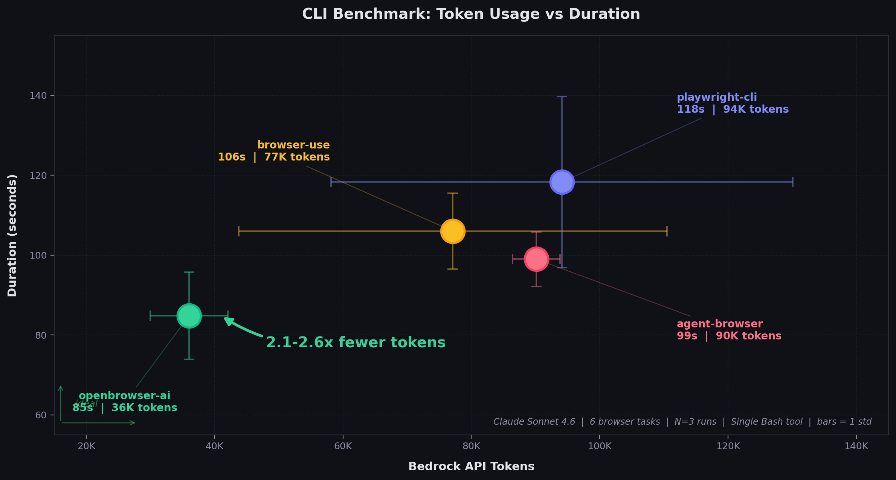
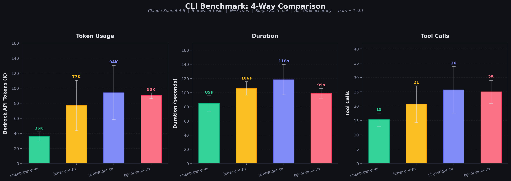
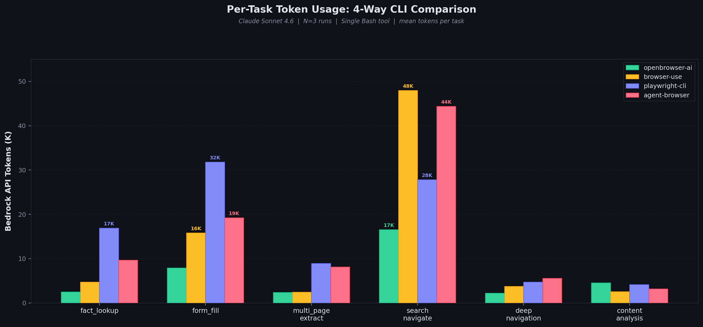
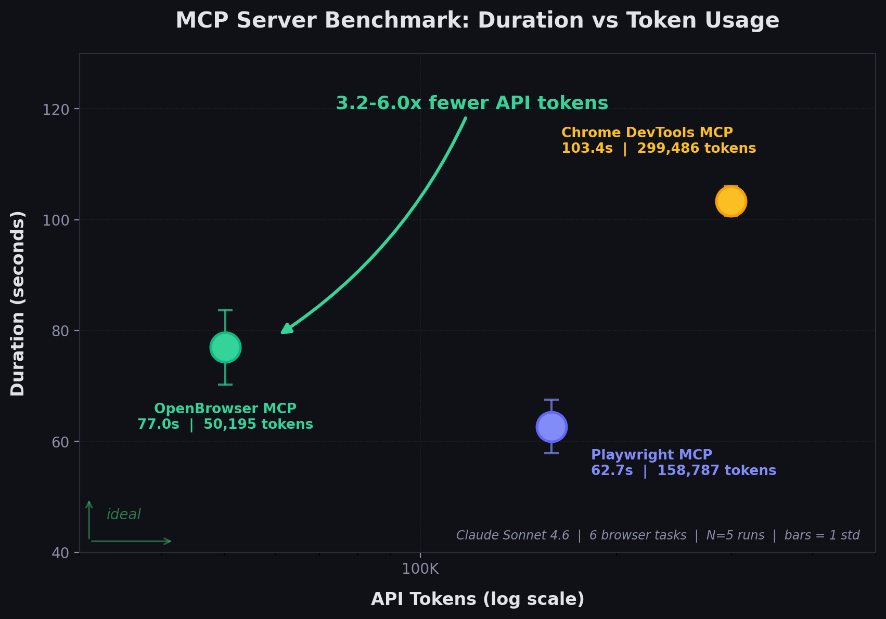

<p align="center">
  
</p>

<h1 align="center">OpenBrowser</h1>

<p align="center"><strong>AI browser automation, powered by code.</strong></p>

---

**Cloud dashboard for saved cookies and scheduled tasks is available in the hosted version. Join the waitlist for early access: https://openbrowser.me** :

https://github.com/user-attachments/assets/b17f97f3-f9f8-4707-8e39-abbbbe1a693b

**Automating Walmart Product Scraping:**

https://github.com/user-attachments/assets/c517c739-9199-47b0-bac7-c2c642a21094

**OpenBrowserAI Automatic Flight Booking:**

https://github.com/user-attachments/assets/632128f6-3d09-497f-9e7d-e29b9cb65e0f

**OpenBrowserAI Automatic Form Filling:**

https://github.com/user-attachments/assets/16f7ef1a-beb1-45e2-a733-9592536e0ef7


[](https://pypi.org/project/openbrowser-ai/)
[](https://pepy.tech/projects/openbrowser-ai)
[](https://www.python.org/downloads/)
[](https://opensource.org/licenses/MIT)
[](https://github.com/billy-enrizky/openbrowser-ai/actions)
[](https://codecov.io/gh/billy-enrizky/openbrowser-ai)

<!-- mcp-name: me.openbrowser/openbrowser-ai -->

**AI-powered browser automation using CodeAgent and CDP (Chrome DevTools Protocol)**

OpenBrowser is a framework for intelligent browser automation. It combines direct CDP communication with a CodeAgent architecture, where the LLM writes Python code executed in a persistent namespace, to navigate, interact with, and extract information from web pages autonomously.

<!-- toc:start -->
## Contents

- [1. Documentation](#1-documentation)
- [2. Key Features](#2-key-features)
- [3. Installation](#3-installation)
  - [3.1. Quick install (macOS / Linux)](#31-quick-install-macos-linux)
  - [3.2. Quick install (Windows PowerShell)](#32-quick-install-windows-powershell)
  - [3.3. Homebrew (macOS / Linux)](#33-homebrew-macos-linux)
  - [3.4. pip](#34-pip)
  - [3.5. uv (recommended)](#35-uv-recommended)
  - [3.6. uvx (zero install)](#36-uvx-zero-install)
  - [3.7. pipx](#37-pipx)
  - [3.8. From source](#38-from-source)
  - [3.9. Optional Dependencies](#39-optional-dependencies)
- [4. Quick Start](#4-quick-start)
  - [4.1. Basic Usage](#41-basic-usage)
  - [4.2. With Different LLM Providers](#42-with-different-llm-providers)
  - [4.3. Using Browser Session Directly](#43-using-browser-session-directly)
- [5. Configuration](#5-configuration)
  - [5.1. Config file lifecycle](#51-config-file-lifecycle)
  - [5.2. Environment Variables](#52-environment-variables)
  - [5.3. BrowserProfile Options](#53-browserprofile-options)
- [6. Supported LLM Providers](#6-supported-llm-providers)
- [7. Claude Code Plugin](#7-claude-code-plugin)
- [8. skills.sh](#8-skillssh)
- [9. Codex](#9-codex)
  - [9.1. Quick Install](#91-quick-install)
  - [9.2. Manual Install](#92-manual-install)
- [10. OpenCode](#10-opencode)
  - [10.1. Quick Install](#101-quick-install)
  - [10.2. Manual Install](#102-manual-install)
- [11. OpenClaw](#11-openclaw)
- [12. MCP Server](#12-mcp-server)
  - [12.1. Quick Setup](#121-quick-setup)
  - [12.2. Tools](#122-tools)
  - [12.3. Configuration](#123-configuration)
- [13. Benchmark: Token Efficiency](#13-benchmark-token-efficiency)
  - [13.1. Native Local Benchmarks (2026-11-25)](#131-native-local-benchmarks-2026-11-25)
  - [13.2. CLI Benchmark: 4-Way Comparison (6 Tasks, N=3 runs)](#132-cli-benchmark-4-way-comparison-6-tasks-n3-runs)
    - [13.2.1. Per-Task Token Usage](#1321-per-task-token-usage)
    - [13.2.2. Cost per Benchmark Run (6 Tasks)](#1322-cost-per-benchmark-run-6-tasks)
  - [13.3. E2E LLM Benchmark: MCP Server Comparison (6 Tasks, N=5 runs)](#133-e2e-llm-benchmark-mcp-server-comparison-6-tasks-n5-runs)
- [14. CLI Usage](#14-cli-usage)
- [15. Project Structure](#15-project-structure)
- [16. Testing](#16-testing)
  - [16.1. Benchmarks](#161-benchmarks)
- [17. Backend and Frontend Deployment](#17-backend-and-frontend-deployment)
  - [17.1. Prerequisites](#171-prerequisites)
  - [17.2. Local Development (Docker Compose)](#172-local-development-docker-compose)
  - [17.3. Full Stack (Docker Compose)](#173-full-stack-docker-compose)
  - [17.4. Backend](#174-backend)
  - [17.5. Frontend](#175-frontend)
  - [17.6. Environment Variables](#176-environment-variables)
- [18. Research: Reinforcement Fine-Tuning for Browser Agents](#18-research-reinforcement-fine-tuning-for-browser-agents)
  - [18.1. Study 1: Browser-in-the-Loop (Autoregressive RL)](#181-study-1-browser-in-the-loop-autoregressive-rl)
  - [18.2. Study 2: Diffusion Language Models for Web Action Planning](#182-study-2-diffusion-language-models-for-web-action-planning)
  - [18.3. Reproducing RL Experiments](#183-reproducing-rl-experiments)
- [19. Contributing](#19-contributing)
- [20. License](#20-license)
- [21. Contact](#21-contact)

<!-- toc:end -->

## 1. Documentation

**Full documentation**: [https://docs.openbrowser.me](https://docs.openbrowser.me)

## 2. Key Features

- **CodeAgent Architecture** - LLM writes Python code in a persistent Jupyter-like namespace for browser automation
- **Raw CDP Communication** - Direct Chrome DevTools Protocol for maximum control and speed
- **Native Web Search** - The package-native DDGS client in Python, the CLI, CodeAgent, and MCP. Search snippets do not count as evidence.
- **Vision Support** - Screenshot analysis for visual understanding of pages
- **15 LLM Providers** - OpenAI, Anthropic, Google, Groq, AWS Bedrock, Azure, Ollama, DeepSeek, Cerebras, OpenRouter, OCI, and more
- **MCP Server** - Model Context Protocol for Claude Desktop, Claude Code, Codex, OpenCode, and other AI assistants.
  Modern clients use explicit contexts and isolated profiles. The server includes read-only status and reset tools.
- **CLI Daemon** - Persistent browser daemon with `-c` flag for direct code execution from Bash, explicit startup ownership, health and recovery status, saved login state, and 10-minute auto-shutdown
- **Fast CLI paths** - `-c` uses a standard-library thin client against a warm daemon. `scrape --no-browser` uses OpenBrowser no-browser mode: a light console entry that starts no Chrome, Blink, or V8 process and does not import the browser or configuration stack
- **Batch scraping** - `scrape_pages` and the CLI batch scrape multiple URLs with bounded concurrency. An explicit `--no-browser` or `--engine http` batch starts no browser
- **Explicit Lifecycle State** - Browser, CDP, navigation, focus, storage, downloads, agent runs, and CodeAgent runs report typed phases instead of relying on logs
- **Workflow Recording** - Record, replay, and export browser sessions to Jupyter notebooks or API crawler code
- **Video Recording** - Record browser sessions as video files with ffmpeg
- **Cloud Platform** - Full-stack web UI with real-time VNC streaming, saved logins (KMS-encrypted), scheduled workflows (EventBridge + SQS), and email notifications (SES)
- **Plugin System** - Claude Code plugin and skills.sh pack with 8 guided skills (setup, deep research, web scraping, form filling, e2e testing, page analysis, accessibility audit, file download)

## 3. Installation

### 3.1. Quick install (macOS / Linux)

```bash
curl -fsSL https://raw.githubusercontent.com/billy-enrizky/openbrowser-ai/main/install.sh | sh
```

### 3.2. Quick install (Windows PowerShell)

```powershell
irm https://raw.githubusercontent.com/billy-enrizky/openbrowser-ai/main/install.ps1 | iex
```

The installers require Python 3.12 or newer. They use `uv`, then `pipx`, then `pip`.

To request a pip user install with `--local`, run:

```bash
curl -fsSL https://raw.githubusercontent.com/billy-enrizky/openbrowser-ai/main/install.sh | sh -s -- --local
```

The installer still prefers `uv` or `pipx` when either is available. The flag changes the pip fallback to `pip install --user`.

### 3.3. Homebrew (macOS / Linux)

```bash
brew tap billy-enrizky/openbrowser
brew install openbrowser-ai
```

### 3.4. pip

```bash
pip install openbrowser-ai
```

### 3.5. uv (recommended)

```bash
uv tool install openbrowser-ai
```

### 3.6. uvx (zero install)

Run without installing the CLI. `uvx` downloads and caches the package.

```bash
# MCP server mode
uvx openbrowser-ai --mcp

# CLI daemon mode
uvx openbrowser-ai -c "await navigate('https://example.com')"

# Native web search. This command does not start Chromium.
uvx openbrowser-ai search "OpenBrowser MCP docs"
uvx openbrowser-ai search "OpenBrowser MCP docs" --json --output search-results.json
uvx openbrowser-ai search "OpenBrowser MCP docs" --urls-only --output search-urls.txt
uvx openbrowser-ai scrape --urls-file search-urls.txt --no-browser --output scraped-pages.jsonl --output-format jsonl

# OpenBrowser no-browser mode: no Chrome, Blink, or V8 process
uvx openbrowser-ai scrape https://example.com --no-browser --format markdown
uvx openbrowser-ai scrape https://example.com --format json --selector "article"
uvx openbrowser-ai scrape https://example.com --render-mode no-render

# One-shot task with lightweight rendering
uvx openbrowser-ai --render-mode lightweight -p "Read the page title"

# One-shot task without screenshots or visual-only actions
uvx openbrowser-ai --no-render -p "Read the page title"

# Batch scrape with bounded HTTP concurrency
uvx openbrowser-ai scrape https://a.example https://b.example --jsonl --concurrency 8
uvx openbrowser-ai scrape --urls-file urls.txt --output results.jsonl
```

`scrape` accepts multiple URLs or a file with one URL per line. Use `--output-format json` or `--output-format jsonl` to select batch output. A `.jsonl` output path selects JSONL by default. Each result records its URL, success state, engine, content or error, duration, and timing. One failed URL does not stop the batch.

`--no-browser` is OpenBrowser no-browser mode. It starts no Chrome, Blink, or V8 process, never falls back to a browser, and cannot run JavaScript, take screenshots, or use browser cookies. The asset flags `--no-css`, `--no-images`, `--no-fonts`, `--no-media`, and `--render-mode` control the browser fallback, not the no-browser HTTP path. Use the default `auto` engine or `--engine browser` when a page needs JavaScript.

In CodeAgent and MCP execution, call `await scrape_pages(urls, concurrency=4)`. HTTP requests run concurrently up to the limit. Browser fallbacks run sequentially, and each URL returns its own result.

`openbrowser-ai search` prints a compact table by default. Use `--json` for a JSON array or `--urls-only` to write one URL per line. Search snippets do not count as evidence. Scrape and read each source page before you cite it. The package caps `max_results` at 20.

The Python API exports synchronous `search` and asynchronous `asearch` from `openbrowser.search`. The `openbrowser-ai search` command calls this client directly; it does not shell out to a `ddgs` CLI. Both functions return typed `SearchResult` values with `title`, `url`, and `snippet` fields. Provider failures raise `SearchError`. The error recommends browser search as a fallback.

```python
from openbrowser.search import search

results = search("OpenBrowser MCP", max_results=5)
```

Inside an async function, import and await `asearch`:

```python
from openbrowser.search import asearch

results = await asearch("OpenBrowser MCP", max_results=5)
```

The render modes are `full`, `lightweight`, and `no-render`. Full mode uses normal browser rendering. Lightweight mode blocks images, web fonts, and media. No-render mode disables screenshots and visual-only actions. For one-shot prompt runs, pass `--render-mode` or use `--no-render` as a shortcut for `--render-mode no-render`. The `scrape` command accepts `--render-mode`; `--lightweight` selects lightweight rendering.

### 3.7. pipx

```bash
pipx install openbrowser-ai
```

### 3.8. From source

```bash
git clone https://github.com/billy-enrizky/openbrowser-ai.git
cd openbrowser-ai
uv venv --python 3.12
source .venv/bin/activate
uv pip install -e ".[all]"
```

### 3.9. Optional Dependencies

```bash
pip install openbrowser-ai             # CLI, MCP, Agent, and CodeAgent (base package)
pip install openbrowser-ai[all]        # Optional providers plus the interactive CLI
pip install openbrowser-ai[anthropic]  # Anthropic Claude
pip install openbrowser-ai[groq]       # Groq
pip install openbrowser-ai[ollama]     # Ollama (local models)
pip install openbrowser-ai[aws]        # AWS Bedrock
pip install openbrowser-ai[azure]      # Azure OpenAI
pip install openbrowser-ai[video]      # Video recording support
```

> **No separate browser install needed.** OpenBrowser auto-detects any installed Chromium-based browser (Chrome, Edge, Brave, Chromium) and uses it directly. If none is found and `uvx` is available, Chromium is installed automatically on first run. To pre-install manually (requires `uvx`): `openbrowser-ai install`

## 4. Quick Start

### 4.1. Basic Usage

```python
import asyncio
from openbrowser import CodeAgent, ChatGoogle

async def main():
    agent = CodeAgent(
        task="Go to google.com and search for 'Python tutorials'",
        llm=ChatGoogle(model="gemini-3-flash-preview"),
    )

    session = await agent.run()
    print(f"Result: {agent.status.result}")
    print(f"Executed cells: {len(session.cells)}")

asyncio.run(main())
```

By default, CodeAgent keeps generated files under a unique temporary agent
directory. Pass `file_system=FileSystem(base_dir=...)` when a stable path is
required. Constructing `FileSystem` clears `<base_dir>/openbrowser_agent_data`,
so keep that subdirectory disposable or use a fresh base directory per run.

### 4.2. With Different LLM Providers

```python
from openbrowser import CodeAgent, ChatOpenAI, ChatAnthropic, ChatGoogle

# OpenAI
agent = CodeAgent(task="...", llm=ChatOpenAI(model="gpt-5.2"))

# Anthropic
agent = CodeAgent(task="...", llm=ChatAnthropic(model="claude-sonnet-4-6"))

# Google Gemini
agent = CodeAgent(task="...", llm=ChatGoogle(model="gemini-3-flash-preview"))
```

### 4.3. Using Browser Session Directly

```python
import asyncio
from openbrowser import BrowserSession, BrowserProfile

async def main():
    profile = BrowserProfile(
        headless=True,
        viewport={"width": 1920, "height": 1080},
    )
    
    session = BrowserSession(browser_profile=profile)
    await session.start()
    
    await session.navigate_to("https://example.com")
    screenshot = await session.take_screenshot()
    
    await session.stop()

asyncio.run(main())
```

`await session.navigate_to(url)` waits for the document's `load` milestone, not a fixed delay. Use keyword options such as `wait_until="domcontentloaded"` and `timeout_ms=10000` to choose another milestone and deadline. Supported milestones are `commit`, `domcontentloaded`, `load`, and Chromium's `networkIdle` lifecycle event through `wait_until="networkidle"`. They do not establish application hydration or business-task completion.

Cancelling `navigate_to()` cancels that request without replaying navigation. An overlapping request raises `NavigationBusyError`; wait for the active request to finish before trying again. A download handoff still returns `None`, but is recorded as `download`, not document readiness. `session.lifecycle_snapshot()["navigation"]` reports the active or last operation, including its requested URL, observed URL, generation, phase, and error.

When CodeAgent extracts an initial URL from its task, it awaits the registered `navigate` action without an additional fixed delay. The default action awaits the navigation contract above. If you replace `navigate` with a custom action, that action must await the readiness your task needs before returning. CodeAgent does not add a load or hydration check after a custom action returns, even if the action waits only for `commit`.

## 5. Configuration

### 5.1. Config file lifecycle

OpenBrowser reads `config.json` from `OPENBROWSER_CONFIG_PATH`, then `OPENBROWSER_CONFIG_DIR/config.json`, then `XDG_CONFIG_HOME/openbrowser/config.json`. Run `uvx openbrowser-ai config status` to inspect the selected path and its state as JSON. If the selected file does not exist, the status check creates the default once.

A missing file is created once with defaults. A legacy, invalid, or unreadable file is never rewritten automatically. Browser startup is blocked with a stable `config_*` error code and a repair hint. If you can fix the file in place, do that and restart any running daemon or MCP server. If you want a fresh default, move the file to a unique backup name first. Moving it aside creates a new default on the next start and does not migrate the old settings. Keep the backup because it may contain proxy credentials or API keys.

```bash
uvx openbrowser-ai config status
# Move the exact "path" value reported by the command. Do not assume the default path.
mv <path-from-status> <path-from-status>.invalid.$(date +%Y%m%d%H%M%S)
uvx openbrowser-ai config status
```

`daemon status` and MCP `get_status` include an additive `config` block with the startup snapshot, current snapshot, and `restart_required`. A long-lived daemon or MCP process does not hot reload config.

When a profile is present, both status surfaces include `profile.resolution`. Daemon status resolves the profile before the first browser start. MCP `get_status` includes it after the context has resolved its profile. Each entry has a `source` key plus a `value`, or a `mode` and optional `count`. The source is `default`, `config`, `environment`, `managed`, or `cli`. Paths, booleans, channel, executable, download path, action delay, scale factor, and security mode report a value. Storage state, proxy, and launch arguments report only a mode and source, with an argument count for `args`, so cookies, proxy credentials, and argument values stay out of status.

When a browser session exists, status includes `browser.cdp` with the root connection phase, client presence, last probe time and latency, a closed error code, and any pending cleanup. `cdp.healthy` is the last accepted connect or probe observation while the lifecycle preserves an active health claim; an inactive snapshot can report `null` and keeps the history fields. Use `cdp.last_probe_at` to tell whether a probe has run and how recent it is. `cdp.phase` is one of `disconnected`, `resolving`, `connecting`, `connected`, `degraded`, or `failed`. `cdp.last_error_code` is `null` or one of `not_connected`, `timeout`, `connection_closed`, `session_not_found`, `probe_failed`, `connect_failed`, or `cancelled`. `session_not_found` can come from target attachment during connect setup, not from the root probe alone. `cdp_connected` is a legacy pointer-presence alias, not a health result. Root CDP health does not prove a target session, tab, or page can accept commands. Daemon status reports the last observation without probing. MCP probes an existing session before execution when time remains, while `get_status` itself stays read-only and does not probe or start a browser.

The same status surfaces add `browser.health` when a session exists. `health.phase` is `unknown`, `healthy`, `degraded`, `crashed`, `stopped`, or `failed`. The block records page-target crash history, the latest focus-recovery outcome, and a status-time local process check. `health.healthy=true` means setup or focus recovery was observed, not that a page can accept commands. `process_present` is `null` when the published CDP root is not bound to the recorded local owner, or when process identity is inconclusive. That includes remote browsers, stopped sessions, and ambiguous PID reuse. `health` never performs a page probe or starts a browser. A status response without `health` means no browser session exists.

### 5.2. Environment Variables

```bash
# Google (recommended)
export GOOGLE_API_KEY="..."

# OpenAI
export OPENAI_API_KEY="sk-..."

# Anthropic
export ANTHROPIC_API_KEY="sk-ant-..."

# Groq
export GROQ_API_KEY="gsk_..."

# AWS Bedrock
export AWS_ACCESS_KEY_ID="..."
export AWS_SECRET_ACCESS_KEY="..."
export AWS_DEFAULT_REGION="us-west-2"

# Azure OpenAI
export AZURE_OPENAI_API_KEY="..."
export AZURE_OPENAI_ENDPOINT="https://your-resource.openai.azure.com/"
```

### 5.3. BrowserProfile Options

```python
from openbrowser import BrowserProfile

profile = BrowserProfile(
    headless=True,
    viewport={"width": 1280, "height": 720},
    disable_security=False,
    extra_chromium_args=["--disable-gpu"],
    record_video_dir="./recordings",
    proxy={
        "server": "http://proxy.example.com:8080",
        "username": "user",
        "password": "pass",
    },
)
```

## 6. Supported LLM Providers

| Provider | Class | Models |
|----------|-------|--------|
| **Google** | `ChatGoogle` | gemini-3-flash-preview, gemini-3-pro |
| **OpenAI** | `ChatOpenAI` | gpt-5.2, o4-mini, o3 |
| **Anthropic** | `ChatAnthropic` | claude-sonnet-4-6, claude-opus-4-6 |
| **Groq** | `ChatGroq` | llama-4-scout, qwen3-32b |
| **AWS Bedrock** | `ChatAWSBedrock` | anthropic.claude-sonnet-4-6, amazon.nova-pro |
| **AWS Bedrock (Anthropic)** | `ChatAnthropicBedrock` | Claude models via Anthropic Bedrock SDK |
| **Azure OpenAI** | `ChatAzureOpenAI` | Any Azure-deployed model |
| **OpenRouter** | `ChatOpenRouter` | Any model on openrouter.ai |
| **DeepSeek** | `ChatDeepSeek` | deepseek-chat, deepseek-r1 |
| **Cerebras** | `ChatCerebras` | llama-4-scout, qwen-3-235b |
| **Ollama** | `ChatOllama` | llama-4-scout, deepseek-r1 (local) |
| **OCI** | `ChatOCIRaw` | Oracle Cloud GenAI models |
| **Browser-Use** | `ChatBrowserUse` | External LLM service |

## 7. Claude Code Plugin

Install OpenBrowser as a Claude Code plugin:

```bash
# Add the marketplace (one-time)
claude plugin marketplace add billy-enrizky/openbrowser-ai

# Install the plugin
claude plugin install openbrowser@openbrowser-ai
```

This installs the MCP server and 8 built-in skills:

| Skill | Description |
|-------|-------------|
| `setup` | Install the CLI and browser, configure MCP and profiles, and verify a real session |
| `deep-research` | Conduct cited, multi-source web research and produce markdown and JSON reports |
| `web-scraping` | Extract structured data, handle pagination |
| `form-filling` | Fill forms, login flows, multi-step wizards |
| `e2e-testing` | Test web apps by simulating user interactions |
| `page-analysis` | Analyze page content, structure, metadata |
| `accessibility-audit` | Audit pages for WCAG compliance |
| `file-download` | Download files (PDFs, CSVs) using browser session |

See [plugin/README.md](plugin/README.md) for detailed tool parameter documentation.

## 8. skills.sh

Install the OpenBrowser skill pack with the [skills.sh](https://skills.sh) CLI:

```bash
npx skills add billy-enrizky/openbrowser-ai
```

Install only the first-time setup skill:

```bash
npx skills add billy-enrizky/openbrowser-ai --skill setup -a codex
```

The pack includes `setup`, `deep-research`, `web-scraping`, `form-filling`, `e2e-testing`, `page-analysis`, `accessibility-audit`, and `file-download`. These commands install skill definitions. They do not run the setup workflow. After installation, invoke the `setup` skill to install the CLI and Chromium, configure MCP and profiles, and verify a real browser session. Skills are installed to the current project by default; add `-g` for all projects.

## 9. Codex

OpenBrowser works with OpenAI Codex via native skill discovery.

### 9.1. Quick Install

Tell Codex:

```
Fetch and follow instructions from https://raw.githubusercontent.com/billy-enrizky/openbrowser-ai/refs/heads/main/.codex/INSTALL.md
```

### 9.2. Manual Install

```bash
# Clone the repository
git clone https://github.com/billy-enrizky/openbrowser-ai.git ~/.codex/openbrowser

# Symlink skills for native discovery
mkdir -p ~/.agents/skills
ln -s ~/.codex/openbrowser/plugin/skills ~/.agents/skills/openbrowser

# Restart Codex
```

Then configure the MCP server in your project (see [MCP Server](#12-mcp-server) below).

Detailed docs: [.codex/INSTALL.md](.codex/INSTALL.md)

## 10. OpenCode

OpenBrowser works with [OpenCode.ai](https://opencode.ai) via plugin and skill symlinks.

### 10.1. Quick Install

Tell OpenCode:

```
Fetch and follow instructions from https://raw.githubusercontent.com/billy-enrizky/openbrowser-ai/refs/heads/main/.opencode/INSTALL.md
```

### 10.2. Manual Install

```bash
# Clone the repository
git clone https://github.com/billy-enrizky/openbrowser-ai.git ~/.config/opencode/openbrowser

# Create directories
mkdir -p ~/.config/opencode/plugins ~/.config/opencode/skills

# Symlink plugin and skills
ln -s ~/.config/opencode/openbrowser/.opencode/plugins/openbrowser.js ~/.config/opencode/plugins/openbrowser.js
ln -s ~/.config/opencode/openbrowser/plugin/skills ~/.config/opencode/skills/openbrowser

# Restart OpenCode
```

Then configure the MCP server in your project (see [MCP Server](#12-mcp-server) below).

Detailed docs: [.opencode/INSTALL.md](.opencode/INSTALL.md)

## 11. OpenClaw

[OpenClaw](https://openclaw.ai) supports OpenBrowser via the CLI daemon. Install OpenBrowser,
then use `openbrowser-ai -c` from the Bash tool:

Before a sequence of calls, run `openbrowser-ai warm` once to start the daemon and browser.

```bash
openbrowser-ai warm
openbrowser-ai -c "await navigate('https://example.com')"
openbrowser-ai -c "print(await evaluate('document.title'))"
```

The daemon starts automatically on first use and persists variables across calls.

For OpenClaw plugin documentation, see [docs.openclaw.ai/tools/plugin](https://docs.openclaw.ai/tools/plugin).

## 12. MCP Server

[](https://registry.modelcontextprotocol.io/?q=openbrowser)

OpenBrowser includes an MCP (Model Context Protocol) server that exposes browser automation as tools for AI assistants like Claude. Listed on the [MCP Registry](https://registry.modelcontextprotocol.io/?q=openbrowser) as `me.openbrowser/openbrowser-ai`. The default stdio transport is a lean JSON-RPC loop that answers discovery and the tool catalog before it imports the MCP SDK. It negotiates protocol version `2026-07-28` with modern clients. Set `OPENBROWSER_MCP_TRANSPORT=sdk` to use the MCP SDK 2.3 escape hatch. Invalid values exit with code 2. No external LLM API keys required: the MCP client provides the intelligence.

By default, each modern MCP context uses an isolated managed profile under `~/.config/openbrowser/profiles/mcp-<owner-id>`. The legacy no-handle owner uses `mcp-<server-instance-id>`. The owner ID is internal and is not the `context_id` handle; read the resolved path from `get_status.profile.user_data_dir`. The profile's `storage_state.json` is seeded once from `~/.config/openbrowser/profiles/default/storage_state.json`, so existing logins are available without allowing concurrent contexts to kill or corrupt one another's browser. Profiles are retained on disk after `close_context`. A new MCP server process cannot resume a context handle, and it creates a new isolated profile unless you configure an explicit shared profile. Configure `OPENBROWSER_USER_DATA_DIR` for a profile that survives restarts; `OPENBROWSER_STORAGE_STATE` is a one-time seed for managed profiles, and later changes are saved to the active profile copy rather than copied back automatically. OpenBrowser also auto-cleans disposable Chromium caches in managed profiles, which keeps disk usage down without deleting cookies or login state. If you explicitly configure the same `OPENBROWSER_USER_DATA_DIR` for multiple contexts or servers, the profile lease rejects the second owner with a clear error.

### 12.1. Quick Setup

**Claude Code**: add to your project's `.mcp.json`:

```json
{
  "mcpServers": {
    "openbrowser": {
      "command": "uvx",
      "args": ["openbrowser-ai", "--mcp"]
    }
  }
}
```

**Claude Desktop**: add to `~/Library/Application Support/Claude/claude_desktop_config.json`:

```json
{
  "mcpServers": {
    "openbrowser": {
      "command": "uvx",
      "args": ["openbrowser-ai", "--mcp"],
      "env": {
        "OPENBROWSER_HEADLESS": "true"
      }
    }
  }
}
```

**Run directly:**

```bash
uvx openbrowser-ai --mcp
```

Set `OPENBROWSER_RENDER_MODE` to `full`, `lightweight`, or `no-render` to choose the policy for new MCP contexts. The default is `full`.

### 12.2. Tools

The MCP server exposes seven tools to modern `2026-07-28` clients and four tools to the legacy handshakes `2024-11-05`, `2025-03-26`, `2025-06-18`, and `2025-11-25`. Both catalogs include the stateless `search_web` tool. The modern catalog adds stateless `scrape_web`, which fetches one HTTP(S) page in OpenBrowser no-browser mode: it starts no Chrome, Blink, or V8 process and cannot run JavaScript, take screenshots, or use browser cookies.

- `create_context` creates an isolated context and returns a server-minted `context_id`. It does not start a browser until the first `execute_code` call.
- `execute_code` runs Python code in the namespace for one context. Modern calls require `context_id`.
- `get_status` returns server, context, browser, profile, tab, tools, downloads, storage-state, namespace-transfer, and config state as JSON. It includes `tools` availability and `downloads` (`count`, `pending`, `recent`, `pdf_detection`). It is read-only and does not start a browser.
- `reset_browser` closes a stuck browser and preserves scalar and scalar-only container variables unless `clear_variables` is true. Inspect `namespace_transfer.dropped` for names that could not be carried. Cookies and localStorage survive because the profile is reused.
- `close_context` closes one context and releases its browser and profile. The handle cannot be used after a successful close.
- `search_web` searches the web with the package-native DDGS client and returns a JSON array. It needs no `context_id` and does not start a browser. Treat snippets as previews. Scrape and read source pages before citing them.
- `scrape_web` fetches one static HTTP(S) page without a browser or `context_id`. This is OpenBrowser no-browser mode: it starts no Chrome, Blink, or V8 process, never falls back to a browser, and cannot run JavaScript, take screenshots, or use browser cookies. Use `execute_code` for JavaScript pages.

A context is process-local. It lives until `close_context` or server exit. A new MCP server process cannot resume it.

The browser session closes after 10 minutes without an `execute_code` call. `get_status` does not refresh that timer. The context handle and scalar variables remain available. The next `execute_code` call starts a fresh browser.

A successful `close_context` invalidates the handle. If cleanup fails, the result is `close_failed` with a retryable flag. Retry `close_context` to finish cleanup. The handle cannot run `execute_code`, `get_status`, or `reset_browser` after a failed close. New calls while closing fail with `context_closing`. Calls after failed close fail with `context_close_failed`.

Clients that negotiate `2024-11-05`, `2025-03-26`, `2025-06-18`, or `2025-11-25` see four tools: `execute_code`, `get_status`, `reset_browser`, and `search_web`. The catalog includes stateless `search_web` and uses a legacy no-handle context. OpenBrowser rejects other protocol versions with MCP error `-32602`.

A modern stateful request without `context_id` fails before it affects a browser. `create_context` does not need a handle. The default limit is 16 open contexts, including the legacy context. Set `OPENBROWSER_MCP_MAX_CONTEXTS` to change the limit.

If a browser connection fails, call `get_status` before retrying. Do not replay a page-changing action blindly because the first attempt may have partially run.

Read `browser.health` after a crash or connection failure. `phase=crashed` means the local process bound to the current root is missing or no longer matches its recorded identity. `phase=degraded` records a page-target crash and reports recovery as `not_attempted`, `pending`, `succeeded`, or `failed`. Wait while recovery is pending. After a failed recovery, inspect `focus.last_error` and reset only when no usable target exists. Use `focus` and `tabs` for target-specific state. A missing `health` block means no context has a browser session.

**Available functions** (use `await` unless noted):

| Category | Functions |
|----------|-----------|
| **Navigation** | `navigate(url, new_tab)`, `go_back()`, `wait(seconds)` |
| **Interaction** | `find_element(role, name, element_id, tag, *, timeout)`, `click_element(...)`, `fill_element(text, ...)`, `click(index)`, `input_text(index, text, clear)`, `scroll(down, pages, index)`, `send_keys(keys)`, `upload_file(index, path)` |
| **Coordinate interaction** | `click_xy(x, y, button, click_count)`, `hover_xy(x, y)`, `scroll_xy(x, y, delta_x, delta_y)` for no-index canvas, PDF, embedded, and native-rendered targets |
| **Dropdowns** | `select_dropdown(index, text)`, `dropdown_options(index)` |
| **Tabs** | `get_tabs()`: list tabs without a DOM scan; `switch(tab_id)`, `close(tab_id)`: accepts the four-character suffix or the full CDP target ID |
| **JavaScript** | `evaluate(code)`: run JS in page context, returns Python objects |
| **Downloads** | `download_file(url, filename)`: download a file using browser cookies; `wait_for_download(timeout, url, lookback, download_ref)`: wait for a terminal phase; `download_outcomes()`, `download_failures()`, `list_downloads()`: synchronous history and directory views |
| **State** | `browser.get_browser_state_summary()`: get page metadata and interactive elements; helpers use a screenshotless read |
| **CSS** | `get_selector_from_index(index)`: get CSS selector for an element |
| **Completion** | `done(text, success, files_to_display)`: signal task completion |

Prefer indexed actions whenever an element index exists. Coordinate actions use CSS viewport pixels, not screenshot pixels. If a screenshot uses a `devicePixelRatio` other than 1, divide its coordinates by `window.devicePixelRatio` before calling an `*_xy` function.

**Bundled libraries**: `json`, `csv`, `re`, `datetime`, `asyncio`, `Path`, `requests`, `numpy`, `pandas`. **Only if installed**: `matplotlib`, `BeautifulSoup`, `pypdf` (`openbrowser-ai[pdf]`), `tabulate`.

### 12.3. Configuration

| Environment Variable | Description | Default |
|---------------------|-------------|---------|
| `OPENBROWSER_MCP_TRANSPORT` | Stdio implementation: `lean` or `sdk`. Invalid values exit with code 2 | `lean` |
| `OPENBROWSER_HEADLESS` | Run browser without GUI | `true` |
| `OPENBROWSER_ALLOWED_DOMAINS` | Comma-separated domain whitelist | (none) |
| `OPENBROWSER_USER_DATA_DIR` | Optional explicit Chrome profile directory. Omit it for one managed profile per context; concurrent owners are rejected | (auto: `~/.config/openbrowser/profiles/mcp-<owner-id>`) |
| `OPENBROWSER_STORAGE_STATE` | Optional JSON file used as a one-time seed for cookies plus localStorage in managed MCP profiles | (auto: per-context copy, seeded from `profiles/default`) |
| `OPENBROWSER_COMPACT_DESCRIPTION` | Minimal tool description (~500 tokens) | `false` |
| `OPENBROWSER_MAX_OUTPUT` | Max output characters per execution | `10000` |
| `OPENBROWSER_MCP_START_TIMEOUT` | Browser startup bound in seconds | `30` |
| `OPENBROWSER_MCP_EXEC_TIMEOUT` | Seconds before a tool call returns a timeout result | `110` |
| `OPENBROWSER_MCP_MAX_CONTEXTS` | Maximum open contexts total, including the legacy no-handle context | `16` |
| `OPENBROWSER_MCP_WORKSPACE_DIR` | Base directory for per-context workspaces | `~/Downloads/openbrowser-mcp/workspace` |
| `OPENBROWSER_SHUTDOWN_TIMEOUT` | Browser and context cleanup bound in seconds | `20` |
| `ANONYMIZED_TELEMETRY` | Set to `false` to disable anonymized usage telemetry | `true` |

## 13. Benchmark: Token Efficiency

The figures below are historical model-driven benchmark results, not a comparison of current tool releases or navigation latency. For a local, no-LLM comparison with pinned runtimes and verified page work, use the [navigation comparison verifier](benchmarks/navigation_compare_README.md), its [counterbalanced policy-fix results](benchmarks/navigation_results_2026-11-15_policy_v2.json), and the retained [earlier results](benchmarks/navigation_results_2026-11-15.json). These report engine, IPC, wait-policy, failure, and cleanup differences rather than declaring a universal winner. They are not MCP or CLI agent-comparison numbers.

### 13.1. Native Local Benchmarks (2026-11-25)

Local deterministic fixtures, no LLM, and interleaved samples with exact oracles. The full method, raw JSONL, and host-load caveats are in [benchmarks/scraping/README.md](benchmarks/scraping/README.md) and [benchmarks/interactive/README.md](benchmarks/interactive/README.md). Build under test: `0.1.59.dev47+gbedbbee6b.d20261125`.

Sequential scraping, N=10, OpenBrowser lightweight against Firecrawl Local `0.1.1`:

| Task | OpenBrowser p50 | Firecrawl Local p50 | Result | Pairs won |
| --- | ---: | ---: | --- | ---: |
| `static_article` | 0.7 ms | 1.2 ms | OpenBrowser 1.7x | 10/10 |
| `pagination` | 2.9 ms | 4.4 ms | OpenBrowser 1.5x | 10/10 |
| `table` | 1.1 ms | 2.9 ms | OpenBrowser 2.6x | 10/10 |
| `js_list` | 15.1 ms | 556.4 ms | OpenBrowser 36.8x | 10/10 |
| `asset_heavy` | 17.1 ms | 570.7 ms | OpenBrowser 33.4x | 10/10 |

OpenBrowser lightweight won 50 of 50 paired samples. The full arm won 49 of 50, with one static sample 0.13 ms slower. The batch surface measured 2.834 ms against Firecrawl Local batch at 13.448 ms, a 4.75x win in 10 of 10 pairs, with no browser started.

Memory depends on the surface. Values are process-tree RSS on a local fixture:

| Path | p50 latency | p50 peak process-tree RSS (MiB) |
| --- | ---: | ---: |
| OpenBrowser no-browser mode, static scrape | 142.7 ms | 47.6 MiB |
| JavaScript scrape, headless shell | 940.1 ms | 355.4 MiB |
| JavaScript scrape, full Chrome | 1296.0 ms | 742.4 MiB |

The `scrape` browser fallback uses the Playwright headless shell by default. `OPENBROWSER_USE_HEADLESS_SHELL=0` restores full Chrome.

Warm interactive, N=5, rotated arm order, lower is better:

| Task | OpenBrowser MCP p50 | OpenBrowser CLI p50 | chrome-devtools-mcp p50 | agent-browser p50 | browser-use p50 |
| --- | ---: | ---: | ---: | ---: | ---: |
| `wizard` | **56 ms** | 120 ms | 3482 ms | 494 ms | 519 ms |
| `modal` | **211 ms** | 268 ms | 2760 ms | 1147 ms | 811 ms |
| `download` | **348 ms** | 395 ms | 772 ms | 438 ms | 573 ms |
| `tabs` | **72 ms** | 131 ms | 1485 ms | 397 ms | 232 ms |

Both OpenBrowser arms have the lowest p50 on all four warm tasks, and both won 5 of 5 pairs on every task against every competitor. All 100 runs passed.

Cold interactive, N=5, rotated arm order, lower is better. The timer measures time to result. Final adapter cleanup runs once outside the timed interval for every arm.

| Task | OpenBrowser MCP p50 | OpenBrowser CLI p50 | chrome-devtools-mcp p50 | agent-browser p50 | browser-use p50 |
| --- | ---: | ---: | ---: | ---: | ---: |
| `wizard` | **569 ms** | 677 ms | 4312 ms | 1573 ms | 1111 ms |
| `modal` | **725 ms** | 841 ms | 3471 ms | 2304 ms | 1744 ms |
| `download` | **860 ms** | 963 ms | 1513 ms | 1484 ms | 1126 ms |
| `tabs` | **593 ms** | 683 ms | 2220 ms | 1393 ms | 797 ms |
| `auth` | **1305 ms** | 1604 ms | 3703 ms | 2506 ms | 2476 ms |

Both OpenBrowser arms have the lowest p50 on all five cold tasks, and both won 5 of 5 pairs on every task against every competitor. Browser-use does not win download or tabs in the current lane. All 125 runs passed the exact oracle and keychain check.

Interactive resource lane, N=5: both OpenBrowser arms have the lowest median child footprint, process-tree RSS, and CPU on all five tasks. Both arms won all 150 eligible pairs per metric. Every cell is N=5 and all 125 observations passed. See [the charted comparison](https://docs.openbrowser.me/comparison).

### 13.2. CLI Benchmark: 4-Way Comparison (6 Tasks, N=3 runs)

Four CLI tools compared with a single Bash tool each. Claude Sonnet 4.6 on Bedrock. Randomized order. All achieve 100% accuracy.

<p align="center">
  
</p>

| CLI Tool | Duration (mean +/- std) | Tool Calls | Bedrock API Tokens | Response Chars |
|----------|------------------------:|-----------:|-------------------:|---------------:|
| **openbrowser-ai** | **84.8 +/- 10.9s** | **15.3 +/- 2.3** | **36,010 +/- 6,063** | **9,452 +/- 472** |
| browser-use | 106.0 +/- 9.5s | 20.7 +/- 6.4 | 77,123 +/- 33,354 | 36,241 +/- 12,940 |
| agent-browser | 99.0 +/- 6.8s | 25.0 +/- 4.0 | 90,107 +/- 3,698 | 56,009 +/- 39,733 |
| playwright-cli | 118.3 +/- 21.4s | 25.7 +/- 8.1 | 94,130 +/- 35,982 | 84,065 +/- 49,713 |

openbrowser-ai uses **2.1-2.6x fewer tokens** than all competitors via Python code batching and compact DOM representation.

<p align="center">
  
</p>

#### 13.2.1. Per-Task Token Usage

<p align="center">
  
</p>

| Task | openbrowser-ai | browser-use | playwright-cli | agent-browser |
|------|---------------:|------------:|---------------:|--------------:|
| fact_lookup | **2,504** | 4,710 | 16,857 | 9,676 |
| form_fill | **7,887** | 15,811 | 31,757 | 19,226 |
| multi_page_extract | **2,354** | 2,405 | 8,886 | 8,117 |
| search_navigate | **16,539** | 47,936 | 27,779 | 44,367 |
| deep_navigation | **2,178** | 3,747 | 4,705 | 5,534 |
| content_analysis | 4,548 | **2,515** | 4,147 | 3,189 |

openbrowser-ai wins 5 of 6 tasks. The advantage is largest on complex pages (search_navigate: 2.9x fewer tokens than browser-use) where code batching avoids repeated page state dumps.

#### 13.2.2. Cost per Benchmark Run (6 Tasks)

| Model | openbrowser-ai | browser-use | playwright-cli | agent-browser |
|-------|---------------:|------------:|---------------:|--------------:|
| Claude Sonnet 4.6 ($3/$15 per M) | **$0.12** | $0.24 | $0.29 | $0.27 |
| Claude Opus 4.6 ($5/$25 per M) | **$0.24** | $0.45 | $0.56 | $0.51 |

Raw results are in [`benchmarks/e2e_4way_cli_results.json`](benchmarks/e2e_4way_cli_results.json). [Full 4-way comparison with methodology](https://docs.openbrowser.me/cli-comparison).

### 13.3. E2E LLM Benchmark: MCP Server Comparison (6 Tasks, N=5 runs)

<p align="center">
  
</p>

| MCP Server | Pass Rate | Duration (mean +/- std) | Tool Calls | Bedrock API Tokens |
|------------|:---------:|------------------------:|-----------:|-------------------:|
| **Playwright MCP** (Microsoft) | 100% | 62.7 +/- 4.8s | 9.4 +/- 0.9 | 158,787 |
| **Chrome DevTools MCP** (Google) | 100% | 103.4 +/- 2.7s | 19.4 +/- 0.5 | 299,486 |
| **OpenBrowser MCP** | 100% | 77.0 +/- 6.7s | 13.8 +/- 2.0 | **50,195** |

OpenBrowser uses **3.2x fewer tokens** than Playwright and **6.0x fewer** than Chrome DevTools. MCP response sizes: Playwright 1,132,173 chars, Chrome DevTools 1,147,244 chars, OpenBrowser 7,853 chars -- a **144x difference**.

[Full MCP comparison with methodology](https://docs.openbrowser.me/comparison)

## 14. CLI Usage

```bash
# Run a browser automation task with an LLM agent
uvx openbrowser-ai -p "Search for Python tutorials on Google"

# Execute code directly via persistent daemon
uvx openbrowser-ai -c "await navigate('https://example.com')"
uvx openbrowser-ai -c "print(await evaluate('document.title'))"

# Daemon management
uvx openbrowser-ai warm             # Start the daemon and browser before the first timed call
uvx openbrowser-ai daemon ensure    # Start or restart a daemon that matches the requested headless and profile settings
uvx openbrowser-ai daemon start     # Start, or restart a daemon whose profile or headless mode differs (auto-starts on first -c call)
uvx openbrowser-ai daemon stop      # Request shutdown; poll status or use force-stop to verify
uvx openbrowser-ai daemon force-stop # Force-stop the current endpoint after verifying the owner
uvx openbrowser-ai daemon status    # Show lifecycle, profile, browser, and tab state
uvx openbrowser-ai daemon reset     # Close the browser but keep the daemon process
uvx openbrowser-ai daemon doctor    # Diagnose socket, PID, profile, and log state
uvx openbrowser-ai daemon list      # List sockets and this user's daemon processes
uvx openbrowser-ai daemon reap      # Stop verified daemons and reap orphaned daemon processes
uvx openbrowser-ai daemon restart   # Restart daemon

# OpenBrowser no-browser mode: no Chrome, Blink, or V8 process
uvx openbrowser-ai scrape https://example.com --no-browser --only-main-content
uvx openbrowser-ai map https://docs.example.com --max-urls 50
uvx openbrowser-ai crawl https://docs.example.com --max-pages 20 --max-depth 2

# Install browser
uvx openbrowser-ai install

# Run MCP server
uvx openbrowser-ai --mcp
```

Before a sequence of `-c` calls, run `openbrowser-ai warm` once to start the daemon and browser:

```bash
openbrowser-ai warm
```

Then run the calls in the same environment. The daemon keeps Python variables between calls while it remains running.

Use `--render-mode full`, `--render-mode lightweight`, or `--render-mode no-render` to choose a rendering policy for a one-shot run, or `--no-render` as a shortcut for the last one. No-render mode disables screenshots and visual-only actions. For asset control without changing the mode, use `--text-only` to block external CSS, images, fonts, media, and text tracks while keeping scripts and screenshots, or one of `--no-css`, `--no-images`, `--no-fonts`, `--no-media`, `--no-scripts`. The `scrape` command accepts `--no-css`, `--no-images`, `--no-fonts`, `--no-media`, and `--render-mode`; `--no-scripts` is available on the one-shot prompt interface. The `scrape` browser fallback uses the Playwright headless shell by default; set `OPENBROWSER_USE_HEADLESS_SHELL=0` to force full Chrome.

The `-c` flag connects to a persistent browser daemon over a Unix socket (localhost TCP on Windows). Variables persist across calls while the daemon is running. The daemon starts automatically on first use and shuts down after 10 minutes of inactivity.

After a browser failure, run `openbrowser-ai daemon status` before retrying because the first call may have partially run. Read `browser.health` for the last crash, focus-recovery, and local process observation. `health` is not a live page-readiness probe. Wait while recovery is pending. After a failed recovery, use `openbrowser-ai daemon reset` only when no usable target exists. Reset clears the Python executor and namespace, so persist values first.

The CLI daemon stores its browser profile in `~/.config/openbrowser/profiles/daemon`, so cookies and login sessions survive daemon restarts through Chrome's user-data directory. An explicit `storage_state` path is still loaded when configured. Custom sockets share the default profile by default to preserve existing logins. Set `OPENBROWSER_DAEMON_PROFILE_ISOLATION=true` or `OPENBROWSER_DAEMON_PROFILE_DIR` when several daemons must run with separate profiles. `OPENBROWSER_USER_DATA_DIR` takes precedence over both and always selects that explicit profile. One-shot `-p` runs use `~/.config/openbrowser/profiles/cli`. Managed profiles automatically clear disposable browser caches on startup and shutdown while keeping auth state.

Execution defaults to 110 seconds so an agent with a 120 second tool timeout receives a structured timeout response. Override it with `OPENBROWSER_EXEC_TIMEOUT` and set `OPENBROWSER_READ_TIMEOUT` above that value if you need longer calls. `OPENBROWSER_DAEMON_INIT_TIMEOUT` bounds browser startup. `OPENBROWSER_SHUTDOWN_TIMEOUT` bounds inner session cleanup, while the daemon reset/stop wrapper waits up to 5 seconds. `OPENBROWSER_IDLE_TIMEOUT` changes the 600-second idle shutdown. The daemon downloads to `~/Downloads/openbrowser-daemon` by default, and those files survive `daemon stop`.

## 15. Project Structure

```
openbrowser-ai/
├── .claude-plugin/            # Claude Code marketplace config
├── .codex/                    # Codex integration
│   └── INSTALL.md
├── .opencode/                 # OpenCode integration
│   ├── INSTALL.md
│   └── plugins/openbrowser.js
├── plugin/                    # Plugin package (skills + MCP config)
│   ├── .claude-plugin/
│   ├── .mcp.json
│   └── skills/                # 8 guided skills
├── src/openbrowser/
│   ├── __init__.py            # Main exports
│   ├── cli.py                 # CLI commands
│   ├── config.py              # Configuration
│   ├── actor/                 # Element interaction
│   ├── agent/                 # LangGraph agent
│   ├── browser/               # CDP browser control
│   ├── code_use/              # Code agent + shared executor
│   ├── daemon/                # Persistent browser daemon (Unix socket)
│   ├── dom/                   # DOM extraction
│   ├── llm/                   # LLM providers
│   ├── mcp/                   # MCP server
│   └── tools/                 # Action registry
├── benchmarks/                # MCP benchmarks and E2E tests
│   ├── playwright_benchmark.py
│   ├── cdp_benchmark.py
│   ├── openbrowser_benchmark.py
│   └── e2e_published_test.py
└── tests/                     # Test suite
```

## 16. Testing

```bash
# Run unit tests
pytest tests/

# Run with verbose output
pytest tests/ -v

# E2E test the MCP server against the published PyPI package
uv run python benchmarks/e2e_published_test.py
```

### 16.1. Benchmarks

Run individual MCP server benchmarks (JSON-RPC stdio, 5-step Wikipedia workflow):

```bash
uv run python benchmarks/openbrowser_benchmark.py   # OpenBrowser MCP
uv run python benchmarks/playwright_benchmark.py     # Playwright MCP
uv run python benchmarks/cdp_benchmark.py            # Chrome DevTools MCP
```

Raw results are in [`benchmarks/e2e_4way_cli_results.json`](benchmarks/e2e_4way_cli_results.json). See [full comparison](https://docs.openbrowser.me/comparison) for methodology.

## 17. Backend and Frontend Deployment

The project includes a FastAPI backend and a Next.js frontend, both containerized with Docker.

### 17.1. Prerequisites

- Docker and Docker Compose
- A `.env` file in the project root with `POSTGRES_PASSWORD` and any LLM API keys (see `backend/env.example`)

### 17.2. Local Development (Docker Compose)

```bash
# Start backend + PostgreSQL (frontend runs locally)
docker-compose -f docker-compose.dev.yml up --build

# In a separate terminal, start the frontend
cd frontend && npm install && npm run dev
```

| Service | URL | Description |
|---------|-----|-------------|
| Backend | http://localhost:8000 | FastAPI + WebSocket + VNC |
| Frontend | http://localhost:3000 | Next.js dev server |
| PostgreSQL | localhost:5432 | Chat persistence |
| VNC | ws://localhost:6080 | Live browser view |

The dev compose mounts `backend/app/` and `src/` as volumes for hot-reload. API keys are loaded from `backend/.env` via `env_file`. The `POSTGRES_PASSWORD` is read from the root `.env` file.

### 17.3. Full Stack (Docker Compose)

```bash
# Start all services (backend + frontend + PostgreSQL)
docker-compose up --build
```

This builds and runs both the backend and frontend containers together with PostgreSQL.

### 17.4. Backend

The backend is a FastAPI application in `backend/` with a Dockerfile at `backend/Dockerfile`. It includes:

- REST API on port 8000
- WebSocket endpoint at `/ws` for real-time agent communication
- VNC support (Xvfb + x11vnc + websockify) for live browser viewing on ports 6080-6090
- Kiosk security: Openbox window manager, Chromium enterprise policies, X11 key grabber daemon
- Health check at `/health`

```bash
# Build the backend image
docker build -f backend/Dockerfile -t openbrowser-backend .

# Run standalone
docker run -p 8000:8000 -p 6080:6080 \
  --env-file backend/.env \
  -e VNC_ENABLED=true \
  -e AUTH_ENABLED=false \
  --shm-size=2g \
  openbrowser-backend
```

### 17.5. Frontend

The frontend is a Next.js application in `frontend/` with a Dockerfile at `frontend/Dockerfile`.

```bash
# Build the frontend image
cd frontend && docker build -t openbrowser-frontend .

# Run standalone
docker run -p 3000:3000 \
  -e NEXT_PUBLIC_API_URL=http://localhost:8000 \
  -e NEXT_PUBLIC_WS_URL=ws://localhost:8000/ws \
  openbrowser-frontend
```

### 17.6. Environment Variables

Key environment variables for the backend (see `backend/env.example` for the full list):

| Variable | Description | Default |
|----------|-------------|---------|
| `GOOGLE_API_KEY` | Google/Gemini API key | (required) |
| `DEFAULT_LLM_MODEL` | Default model for agents | `gemini-3-flash-preview` |
| `AUTH_ENABLED` | Enable Cognito JWT auth | `false` |
| `VNC_ENABLED` | Enable VNC browser viewing | `true` |
| `DATABASE_URL` | PostgreSQL connection string | (optional) |
| `POSTGRES_PASSWORD` | PostgreSQL password (root `.env`) | (required for compose) |

## 18. Research: Reinforcement Fine-Tuning for Browser Agents

Beyond the framework, we conducted two independent research studies on improving browser agents through reinforcement learning, both using the [FormFactory benchmark](https://arxiv.org/abs/2506.01520) (1,250 form-filling tasks across 8 domains) and OpenBrowser's browser execution environment.

### 18.1. Study 1: Browser-in-the-Loop (Autoregressive RL)

We investigated whether reinforcement learning can improve a language model's ability to fill web forms beyond what supervised learning achieves.

- **Method**: Two-phase pipeline -- SFT on Qwen3-8B with QLoRA (992 demonstrations), then online GRPO with live browser execution rewards (composite: 40% submission success + 40% field accuracy + 20% execution completeness)
- **Result**: GRPO achieves 9.1% higher average reward than SFT alone on held-out validation (p=0.007, Wilcoxon signed-rank test). Improvement comes specifically from better form submission, not field filling.
- **Key finding**: SFT is a prerequisite -- without it, the base model generates unstructured text and earns zero reward across all attempts.
- **Paper**: [Browser-in-the-Loop: Reinforcement Fine-Tuning LLM Agents for Web Form Filling](https://www.researchgate.net/profile/Muhammad-Enrizky-Brillian)
- **Models**: [Qwen3-8B-FormFactory-SFT-LoRA](https://huggingface.co/billyenrizky/Qwen3-8B-FormFactory-SFT-LoRA), [Qwen3-8B-FormFactory-GRPO-LoRA](https://huggingface.co/billyenrizky/Qwen3-8B-FormFactory-GRPO-LoRA)

### 18.2. Study 2: Diffusion Language Models for Web Action Planning

We investigated whether diffusion language models -- which generate text by iteratively denoising an entire sequence in parallel rather than left-to-right -- can learn web action planning.

- **Models tested**: ReFusion 8B (masked diffusion with causal LM backbone) and FS-DFM 1.3B (pure discrete flow matching)
- **Result**: After SFT, diffusion models solve 60-69% of tasks vs. 100% for the AR baseline. Token-level RL is universally fragile (2/16 comparisons improve, both insignificant). Sequence-level RL succeeds: MDPO pushes ReFusion to 91.9% (+31.4pp) and ESPO pushes FS-DFM to 87.1% (+18.6pp).
- **Key finding**: The appropriate RL formulation is architecture-dependent. ELBO-based optimization (ESPO) produces concentrated distributions across architectures, while per-step trajectory methods produce multimodal distributions.
- **Paper**: [Concentrate or Collapse: When Reinforcement Learning Meets Diffusion Language Models for Web Planning](https://www.researchgate.net/profile/Muhammad-Enrizky-Brillian)
- **Models**: [10 trained models on HuggingFace](https://huggingface.co/billyenrizky) including ReFusion-8B-MDPO, FS-DFM-1.3B-ESPO-mu8, and more

### 18.3. Reproducing RL Experiments

All training code is in `infra/training/`. Training runs on a single NVIDIA A10G GPU (24GB VRAM) via Anyscale.

```bash
# Study 1: Autoregressive RL (Qwen3-8B)
# SFT phase -- QLoRA fine-tuning on 992 FormFactory demonstrations (2-4 hours)
python infra/training/finetuning/sft_trainer.py

# Online GRPO phase -- browser-in-the-loop reward (4-8 hours per epoch)
# Requires headless Chromium + FormFactory forms server
python infra/training/shared/formfactory_server.py &   # Start form server
python infra/training/finetuning/online_grpo_trainer.py

# Evaluate SFT and GRPO checkpoints on val/test splits
python infra/training/finetuning/eval_sft.py

# Study 2: Diffusion LM RL (ReFusion 8B, FS-DFM 1.3B)
# SFT phase
python infra/training/flow_matching/fsdfm_sft_trainer.py    # FS-DFM SFT
python infra/training/flow_matching/flow_sft_trainer.py      # ReFusion SFT

# Sequence-level RL (best results)
python infra/training/flow_matching/espo_fsdfm_trainer.py    # ESPO on FS-DFM
python infra/training/flow_matching/espo_refusion_trainer.py # ESPO on ReFusion
python infra/training/flow_matching/mdpo_fsdfm_trainer.py    # MDPO on FS-DFM
python infra/training/flow_matching/mdpo_refusion_trainer.py # MDPO on ReFusion

# Submit jobs to Anyscale cloud
python infra/training/anyscale/submit_job.py --config infra/training/anyscale/online_grpo_job.yaml

# Push trained checkpoints to HuggingFace
python infra/training/anyscale/push_checkpoints_to_hf.py

# Serve trained model locally via vLLM or Ollama
python infra/training/serving/serve_vllm.py
python infra/training/serving/export_gguf.py   # Export to GGUF for Ollama
```

Reward function (in `infra/training/shared/reward_functions.py`): composite score = 0.4 * task completion + 0.4 * field accuracy + 0.2 * execution completeness. Online reward (`online_reward.py`) launches headless Chromium, executes the model's action plan, and computes the score from live browser state.

## 19. Contributing

Contributions are welcome! Please:

1. Fork the repository
2. Create a feature branch (`git checkout -b feature/amazing-feature`)
3. Commit your changes (`git commit -m 'Add amazing feature'`)
4. Push to the branch (`git push origin feature/amazing-feature`)
5. Open a Pull Request
6. After CI passes, add the `merge-queue` label. The queue tests the merge tree with the full non-integration suite and all static, frontend, and backend checks, then merges it. Direct merges to `main` are blocked.

## 20. License

This project is licensed under the MIT License - see the [LICENSE](LICENSE) file for details.

## 21. Contact

- **Email**: billy.suharno@gmail.com
- **GitHub**: [@billy-enrizky](https://github.com/billy-enrizky)
- **Repository**: [github.com/billy-enrizky/openbrowser-ai](https://github.com/billy-enrizky/openbrowser-ai)
- **Documentation**: [https://docs.openbrowser.me](https://docs.openbrowser.me)

---

**Made with love for the AI automation community**
