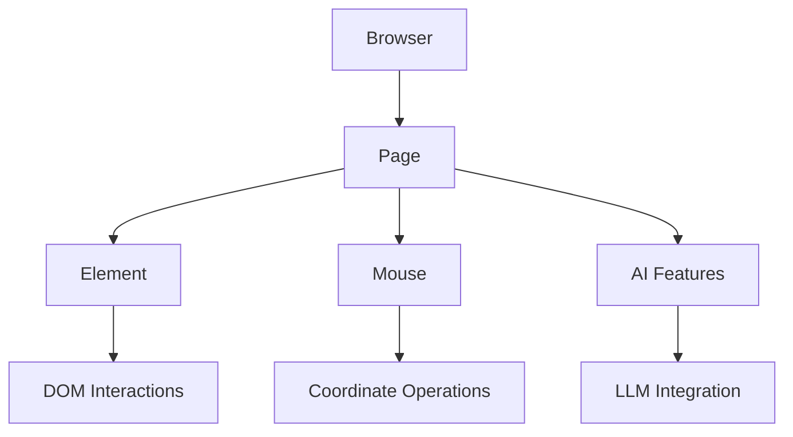

{/* toc:start */}
## Contents

- [1. Core Architecture](#1-core-architecture)
  - [1.1. Core Classes](#11-core-classes)
- [2. Basic Usage](#2-basic-usage)
- [3. Important Notes](#3-important-notes)

{/* toc:end */}

## 1. Core Architecture



### 1.1. Core Classes

- **Browser** (alias: **BrowserSession**): Main session manager
- **Page**: Represents a browser tab/iframe
- **Element**: Individual DOM element operations
- **Mouse**: Coordinate-based mouse operations

## 2. Basic Usage

```python
from openbrowser import Browser, Agent
from openbrowser.llm.openai import ChatOpenAI

async def main():
    llm = ChatOpenAI(model="gpt-4.1-mini", api_key="your-api-key")
    browser = Browser()
    await browser.start()

    # 1. Actor: Precise navigation and element interactions
    page = await browser.new_page("https://github.com/login")
    email_input = await page.must_get_element_by_prompt("username field", llm=llm)
    await email_input.fill("your-username")

    # 2. Agent: AI-driven complex tasks
    agent = Agent(
        task="Complete login and navigate to my repositories",
        browser=browser,
        llm=llm,
    )
    await agent.run()

    await browser.stop()
```

## 3. Important Notes

- **Not Playwright**: Actor is built on CDP, not Playwright. The API resembles Playwright as much as possible for easy migration, but is sorta subset.
- **Immediate Returns**: `get_elements_by_css_selector()` doesn't wait for visibility
- **Manual Timing**: You handle navigation timing and waiting
- **JavaScript Format**: `evaluate()` requires arrow function format: `() => {}`
