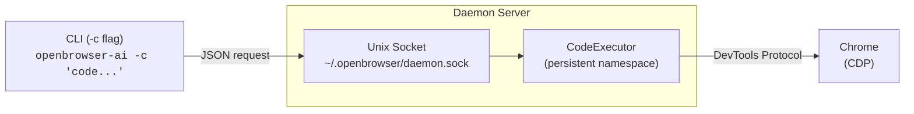

## Overview

The CLI daemon provides a persistent browser session over a Unix socket. Use the `-c` flag to execute Python code directly from Bash -- no MCP server, no LLM, just code and a browser.

The daemon starts automatically on first use, persists variables across calls, and shuts down after 10 minutes of inactivity.

## Quick Start

Before a sequence of `-c` calls, run `openbrowser-ai warm` once to start the daemon and browser. A warm `-c` call uses a standard-library thin client, so it does not import the full CLI or agent stack. A cold call falls back to the full client and starts the daemon.

```bash
# Navigate to a page
uvx openbrowser-ai -c "await navigate('https://example.com')"

# Extract data
uvx openbrowser-ai -c "print(await evaluate('document.title'))"

# Multi-step interaction
uvx openbrowser-ai -c "
await navigate('https://news.ycombinator.com')
state = await browser.get_browser_state_summary()
print(state.title)
print(f'{len(state.dom_state.selector_map)} interactive elements')
"
```

## Native web search

Use `search` to find source URLs without starting Chromium. The command prints a compact table by default.

```bash
openbrowser-ai search "OpenBrowser MCP docs"
openbrowser-ai search "OpenBrowser MCP docs" --json --output search-results.json
openbrowser-ai search "OpenBrowser MCP docs" --urls-only --output search-urls.txt
openbrowser-ai scrape --urls-file search-urls.txt --output scraped-pages.jsonl --output-format jsonl
```

Use `--json` for a JSON array. Use `--urls-only` to write one URL per line. Search snippets do not count as evidence. Scrape and read the source page before you cite it. The package caps `max_results` at 20.

## One-shot scraping

Use `scrape` for deterministic extraction without an LLM. Static pages use HTTP first. Thin JavaScript shells fall back to Chromium.

```bash
# Markdown of a page
openbrowser-ai scrape https://example.com

# Text with images, web fonts, and media blocked
openbrowser-ai scrape https://example.com --format text --render-mode lightweight

# Text with external CSS, images, fonts, and media blocked, screenshots still on
openbrowser-ai scrape https://example.com --format text --text-only

# Keep only the article body, without navigation or footers
openbrowser-ai scrape https://example.com --only-main-content

# JSON from a CSS selector, always in the browser
openbrowser-ai scrape https://example.com --format json --selector "article" --engine browser
```

`--engine auto` is the default. `--engine http` never starts a browser. An explicit `--engine http` command uses a light console entry that does not import the browser or configuration stack. `--render-mode no-render` disables screenshots and visual-only actions for the browser fallback. Use `--wait-for` to wait for a selector on JavaScript-rendered pages.

### Render modes and asset flags

| Mode | Blocks | Screenshots |
| --- | --- | --- |
| `--render-mode full` | nothing | yes |
| `--render-mode lightweight` | images, web fonts, media, text tracks | yes |
| `--render-mode no-render` | the four above plus external stylesheets | no |
| `--text-only` | the same five as `no-render` | yes |

The granular flags change only the asset policy, so they combine with any mode:

- `--no-css` blocks external stylesheets. Inline `<style>` still applies.
- `--no-images`, `--no-fonts`, `--no-media` block one asset group.
- `--no-scripts` blocks scripts and calls `Emulation.setScriptExecutionDisabled`. Use it only for server-rendered pages.
- Each flag has a positive form (`--css`, `--images`, and so on) that re-enables a group a preset blocked.

```bash
# Keep screenshots but skip external CSS
openbrowser-ai --render-mode full --no-css --no-scripts -c "await navigate('https://example.com')"

# Text-only interactive session with scripts
openbrowser-ai --text-only -c "await navigate('https://example.com')"
```

Blocking external CSS exposes content that the page hides with `display:none` or `visibility:hidden`. Use `lightweight` when visibility matters. Asset flags reduce requests and bytes, not Chromium process memory; use `--engine http` or the static path for low memory.

The `scrape` browser fallback uses the installed Playwright headless shell by default. The shell has no browser UI or extension support and uses about half the process memory of full Chrome. Set `OPENBROWSER_USE_HEADLESS_SHELL=0` to force full Chrome.

### Batch scraping

Pass several URLs or a URL file. HTTP requests run concurrently up to `--concurrency`. Browser fallbacks run one at a time because one session has one global agent focus.

```bash
# JSONL on stdout
openbrowser-ai scrape https://a.example https://b.example --jsonl --concurrency 8

# Read one URL per line, then write a JSON array
openbrowser-ai scrape --urls-file urls.txt --output results.json

# Write JSONL when the output path ends in .jsonl
openbrowser-ai scrape --urls-file urls.txt --output results.jsonl
```

For a static batch, add `--engine http`. This path starts no browser and uses the light console entry:

```bash
openbrowser-ai scrape https://a.example https://b.example --engine http --jsonl --concurrency 8
```

`--output-format json|jsonl` selects the batch serialization explicitly. Each batch result has `url`, `ok`, `engine_used`, `content`, `error`, `duration_ms`, and `timing`. A failure for one URL does not abort the batch. A single URL keeps the original content-only output.

## Variable Persistence

Variables set in one `-c` call are available in the next, as long as the daemon is running:

```bash
uvx openbrowser-ai -c "await navigate('https://example.com')"
uvx openbrowser-ai -c "title = await evaluate('document.title')"
uvx openbrowser-ai -c "print(title)"  # still available
```

This enables incremental exploration -- navigate in one call, extract in the next, process in the third.

## Daemon Management

```bash
uvx openbrowser-ai config status    # Inspect the selected config file without starting a browser
uvx openbrowser-ai warm             # Start the daemon and browser before the first timed call
uvx openbrowser-ai daemon ensure    # Start or restart a daemon that matches the requested headless and profile settings
uvx openbrowser-ai daemon start     # Start, or restart a daemon whose profile or headless mode differs (auto-starts on first -c call)
uvx openbrowser-ai daemon stop      # Request shutdown; poll status or use force-stop to verify
uvx openbrowser-ai daemon force-stop # Force-stop the current endpoint after verifying the owner
uvx openbrowser-ai daemon status    # Show lifecycle, profile, browser, and tab state
uvx openbrowser-ai daemon reset     # Close the browser but keep the daemon process
uvx openbrowser-ai daemon doctor    # Diagnose socket, PID, profile, and log state
uvx openbrowser-ai daemon list      # List sockets and this user's daemon processes
uvx openbrowser-ai daemon reap      # Stop verified daemons and reap orphaned daemon processes
uvx openbrowser-ai daemon restart   # Restart with fresh browser session
```

The daemon runs in the background and communicates via a Unix socket at `~/.openbrowser/daemon.sock`. Logs are written next to the socket. The default socket uses `~/.openbrowser/daemon.log`; a custom socket uses `<socket-stem>.log`.

`daemon status` returns `state`, `profile`, `browser`, `exec_timeout`, `init_timeout`, `idle_timeout`, `last_error`, `generation`, `uptime_seconds`, `version`, `startup`, `storage_state`, `storage_state_save`, `namespace_transfer`, `tools`, and `downloads`. It also includes `config.startup`, `config.current`, and `config.restart_required`. Tab state is nested under `browser.tabs` and is omitted until the browser has started. `startup.phase` is `idle`, `checking_ownership`, `cleaning_stale_lock`, `acquiring_ownership`, `binding_socket`, `listening`, `failed`, or `stopped`; `owner_state` is `absent`, `active`, `unresponsive`, or `stale`. `storage_state` reports the last load, and `storage_state_save` reports the last save attempt. `downloads` reports `count`, `pending`, the last 10 attempts with their phases, redacted terminal detail, and `pdf_detection`. `namespace_transfer` records how user variables survived a browser rebuild. The effective profile is resolved before the first browser start, so `daemon ensure` can compare `OPENBROWSER_USER_DATA_DIR`, `OPENBROWSER_DAEMON_PROFILE_DIR`, headless mode, and opted-in socket isolation without launching Chrome. When a browser connection fails, verify the page state and check status before retrying because the first call may have partially run. Use `daemon reset` to close the browser without stopping the daemon process. Reset also clears the Python executor and namespace, so persist values first. Use `daemon doctor` / `daemon reap` when a socket or process is stuck.

Each `profile.resolution` entry has a `source` key plus a `value`, or a `mode` and optional `count`. The source is `default`, `config`, `environment`, `managed`, or `cli`. `storage_state`, `proxy`, and `args` report a mode and source only. They do not include cookies, proxy credentials, or argument values, and `args` includes a count.

When a browser session exists, `browser.cdp` reports the root CDP transport phase, client presence, last probe time and latency, a closed error code, and pending cleanup. `cdp.healthy` is the last accepted connect or probe observation while the lifecycle preserves an active health claim; an inactive snapshot can report `null` and keeps the history fields. Use `cdp.last_probe_at` to tell whether a probe has run and how recent it is. `cdp.phase` is one of `disconnected`, `resolving`, `connecting`, `connected`, `degraded`, or `failed`. `cdp.last_error_code` is `null` or one of `not_connected`, `timeout`, `connection_closed`, `session_not_found`, `probe_failed`, `connect_failed`, or `cancelled`. `session_not_found` can come from target attachment during connect setup, not from the root probe alone. `cdp_connected` only means a client object is present. Root CDP health does not prove a target session, tab, or page can accept commands. Daemon status reports the last observation and does not probe the browser.

`daemon status` adds `browser.health` when a session exists. `health.phase` is `unknown`, `healthy`, `degraded`, `crashed`, `stopped`, or `failed`. The block records page-target crash history, the latest focus-recovery outcome, and a status-time process check. `health.healthy=true` means setup or focus recovery completed, not that a page is ready. Wait while recovery is pending. After a failed recovery, use `daemon reset` only when no usable target exists. `process_present` is `null` when the current CDP root is not bound to the recorded local owner or when process identity is inconclusive, including remote, stopped, and ambiguous local sessions. A missing `health` block means no browser session exists.

Automatic starts for one socket are serialized across processes. The first client starts the daemon; concurrent clients wait, then reuse it. A socket that accepts connections but does not answer status is treated as busy and left alone, because user code may be blocking the daemon event loop. A socket with no listener and no verified OpenBrowser owner is removed before spawning. Use `daemon restart` or `daemon reap` when an owned process must be terminated.

> **Windows**: On Windows, the daemon uses a localhost TCP connection on port 19222 instead of a Unix socket. This means any process on the same machine can connect. The Unix socket on macOS/Linux is restricted to the file owner (mode `0600`).

## Available Functions

All functions from the MCP `execute_code` tool are available in `-c` mode:

| Category | Functions |
|----------|-----------|
| **Navigation** | `navigate(url, new_tab)`, `go_back()`, `wait(seconds)` |
| **Interaction** | `find_element(role, name, element_id, tag, *, timeout)`, `click_element(...)`, `fill_element(text, ...)`, `click(index)`, `input_text(index, text, clear)`, `scroll(down, pages, index)`, `send_keys(keys)`, `upload_file(index, path)` |
| **Coordinate interaction** | `click_xy(x, y, button, click_count)`, `hover_xy(x, y)`, `scroll_xy(x, y, delta_x, delta_y)` for no-index canvas, PDF, embedded, and native-rendered targets |
| **Dropdowns** | `select_dropdown(index, text)`, `dropdown_options(index)` |
| **Tabs** | `get_tabs()`, `switch(tab_id)`, `close(tab_id)` |
| **JavaScript** | `evaluate(code)` -- run JS in page context, returns Python objects |
| **Downloads** | `download_file(url, filename)`; `wait_for_download(timeout, url, lookback, download_ref)`; `download_outcomes()` and `download_failures()` (sync); `list_downloads()` (sync) |
| **Search** | `search_web(query, max_results, backend, region, safe_search, timelimit)`, `search_and_scrape(query, max_results, concurrency, format, ...)` |
| **Scraping** | `scrape_page(url, format, selector, wait_for, engine)`, `scrape_pages(urls, concurrency, format, engine)` |
| **State** | `browser.get_browser_state_summary()` -- page metadata and interactive elements |
| **CSS** | `get_selector_from_index(index)` -- CSS selector for an element |
| **Completion** | `done(text, success)` -- signal task completion |

Prefer indexed actions whenever an element index exists. Coordinate actions use CSS viewport pixels, not screenshot pixels. If a screenshot uses a `devicePixelRatio` other than 1, divide its coordinates by `window.devicePixelRatio` before calling an `*_xy` function.

Downloads default to `~/Downloads/openbrowser-daemon`; files survive `daemon stop` and `daemon reset`.

**Bundled libraries**: `json`, `csv`, `re`, `datetime`, `asyncio`, `Path`, `requests`, `numpy`/`np`, `pandas`/`pd`

Available only if installed: `matplotlib`/`plt`, `BeautifulSoup`, `PdfReader` (`openbrowser-ai[pdf]`), `tabulate`

## Multi-Action Batching

Batch multiple actions in a single call for efficiency:

```bash
uvx openbrowser-ai -c "
await navigate('https://example.com/search')
await input_text(1, 'python automation')
await click(2)
await wait(2)
state = await browser.get_browser_state_summary()
print(f'Results page: {state.title}')
"
```

## Architecture



- The **CLI** is a thin client (about 50 to 60 ms warm startup in the paired benchmark) that sends code over the Unix socket
- The **daemon** holds the browser session, CodeExecutor, and persistent namespace in memory
- The **browser** connects via Chrome DevTools Protocol (CDP)

## Configuration

| Variable | Description | Default |
|----------|-------------|---------|
| `OPENBROWSER_HEADLESS` | Run browser without GUI | `true` |
| `OPENBROWSER_MAX_OUTPUT` | Maximum output characters per execution | `10000` |
| `OPENBROWSER_SOCKET` | Custom Unix socket path | `~/.openbrowser/daemon.sock` |
| `OPENBROWSER_DAEMON_PROFILE_DIR` | Explicit daemon profile directory | `~/.config/openbrowser/profiles/daemon` |
| `OPENBROWSER_DAEMON_PROFILE_ISOLATION` | Give a custom socket its own profile | `false` |
| `OPENBROWSER_DAEMON_INIT_TIMEOUT` | Browser startup bound in seconds | `30` |
| `OPENBROWSER_EXEC_TIMEOUT` | Execution bound in seconds | `110` |
| `OPENBROWSER_IDLE_TIMEOUT` | Shut down an idle daemon after this many seconds | `600` |
| `OPENBROWSER_READ_TIMEOUT` | Client response bound, must exceed exec timeout | `140` |
| `OPENBROWSER_SHUTDOWN_TIMEOUT` | Inner `BrowserSession` cleanup bound in seconds. The daemon reset/stop wrapper waits up to 5 seconds | `20` |

## Comparison with MCP Server

| Feature | CLI Daemon (`-c`) | MCP Server (`--mcp`) |
|---------|-------------------|---------------------|
| **Use case** | Bash scripts, shell pipelines, manual exploration | AI assistants (Claude, Codex) |
| **Intelligence** | You write the code | LLM writes the code |
| **Startup** | ~50 to 60 ms warm (thin client) | ~150ms (full MCP init) |
| **Protocol** | Unix socket (JSON lines) | MCP over stdio |
| **Persistence** | Variables persist across `-c` calls | Variables persist across tool calls |
| **Idle timeout** | Daemon exits after 10 idle minutes | Browser closes after 10 idle minutes; the context remains until `close_context` or server exit |

Both use the same `CodeExecutor` engine and browser automation functions.

## Troubleshooting

**Config blocks the browser**
- Run `uvx openbrowser-ai config status`. A legacy, invalid, or unreadable file stays on disk and blocks browser startup.
- Repair the file in place when possible, then restart the daemon.
- To create a fresh default, move the file to a unique backup name first, run `config status`, and restart the daemon. Moving it aside does not migrate old settings.
- `daemon status` reports `config.startup`, `config.current`, and `config.restart_required`. A running daemon does not hot reload config.
- If no daemon is running, use `config status` directly. `daemon status` only reads the running daemon.

**Daemon won't start**
- Run `uvx openbrowser-ai daemon doctor` and check the reported log tail
- Verify Chrome/Chromium is installed
- Run `uvx openbrowser-ai daemon reap` to stop OpenBrowser-owned daemons and remove stale files
- `daemon list` reports `socket_known` and `socket_live` for each process. A default daemon with no `OPENBROWSER_SOCKET` is checked against the default `daemon.sock`, not treated as socketless.

**"Daemon not running" on status**
- The daemon shuts down after 10 minutes of inactivity
- Run any `-c` command to auto-start it
- If status times out while a command is running, the daemon may be busy rather than dead. Wait for the active execution or use `daemon restart` when termination is intended.

**Socket permission errors**
- The socket is created with `0600` permissions (owner-only)
- Check that `~/.openbrowser/` is owned by your user

**Variables lost between calls**
- A browser recovery inside the daemon preserves user variables. An idle shutdown or process restart clears the namespace. MCP preserves variables across reset and idle expiry because the server process stays alive.
- Use `openbrowser-ai daemon status` to check if the daemon is running
