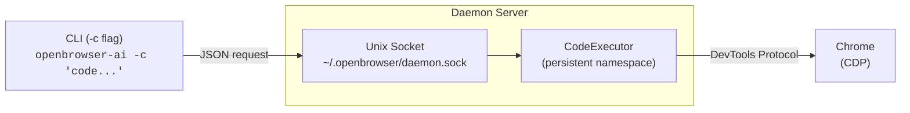

## Overview

The CLI daemon provides a persistent browser session over a Unix socket. Use the `-c` flag to execute Python code directly from Bash -- no MCP server, no LLM, just code and a browser.

The daemon starts automatically on first use, persists variables across calls, and shuts down after 10 minutes of inactivity.

## Quick Start

```bash
# Navigate to a page
uvx openbrowser-ai -c "await navigate('https://example.com')"

# Extract data
uvx openbrowser-ai -c "print(await evaluate('document.title'))"

# Multi-step interaction
uvx openbrowser-ai -c "
await navigate('https://news.ycombinator.com')
state = await browser.get_browser_state_summary()
print(state.title)
print(f'{len(state.dom_state.selector_map)} interactive elements')
"
```

## Variable Persistence

Variables set in one `-c` call are available in the next, as long as the daemon is running:

```bash
uvx openbrowser-ai -c "await navigate('https://example.com')"
uvx openbrowser-ai -c "title = await evaluate('document.title')"
uvx openbrowser-ai -c "print(title)"  # still available
```

This enables incremental exploration -- navigate in one call, extract in the next, process in the third.

## Daemon Management

```bash
uvx openbrowser-ai config status    # Inspect the selected config file without starting a browser
uvx openbrowser-ai daemon ensure    # Start or restart a daemon that matches the requested headless and profile settings
uvx openbrowser-ai daemon start     # Start daemon (auto-starts on first -c call)
uvx openbrowser-ai daemon stop      # Stop daemon and close browser
uvx openbrowser-ai daemon force-stop # Force-stop the current endpoint after verifying the owner
uvx openbrowser-ai daemon status    # Show lifecycle, profile, browser, and tab state
uvx openbrowser-ai daemon reset     # Close the browser but keep the daemon process
uvx openbrowser-ai daemon doctor    # Diagnose socket, PID, profile, and log state
uvx openbrowser-ai daemon list      # List sockets and this user's daemon processes
uvx openbrowser-ai daemon reap      # Stop verified daemons and reap orphaned daemon processes
uvx openbrowser-ai daemon restart   # Restart with fresh browser session
```

The daemon runs in the background and communicates via a Unix socket at `~/.openbrowser/daemon.sock`. Logs are written next to the socket. The default socket uses `~/.openbrowser/daemon.log`; a custom socket uses `<socket-stem>.log`.

`daemon status` returns `state`, `profile`, `browser`, `exec_timeout`, `init_timeout`, and `last_error`. It also includes `config.startup`, `config.current`, and `config.restart_required`. Tab state is nested under `browser.tabs` and is omitted until the browser has started. The effective profile is resolved before the first browser start, so `daemon ensure` can compare `OPENBROWSER_USER_DATA_DIR`, `OPENBROWSER_DAEMON_PROFILE_DIR`, headless mode, and opted-in socket isolation without launching Chrome. When a browser connection fails, check status before retrying because the first call may have partially run. Use `daemon reset` to close the browser without stopping the daemon process, or `daemon doctor` / `daemon reap` when a socket or process is stuck.

Automatic starts for one socket are serialized across processes. The first client starts the daemon; concurrent clients wait, then reuse it. A socket that accepts connections but does not answer status is treated as busy and left alone, because user code may be blocking the daemon event loop. A socket with no listener and no verified OpenBrowser owner is removed before spawning. Use `daemon restart` or `daemon reap` when an owned process must be terminated.

> **Windows**: On Windows, the daemon uses a localhost TCP connection on port 19222 instead of a Unix socket. This means any process on the same machine can connect. The Unix socket on macOS/Linux is restricted to the file owner (mode `0600`).

## Available Functions

All functions from the MCP `execute_code` tool are available in `-c` mode:

| Category | Functions |
|----------|-----------|
| **Navigation** | `navigate(url, new_tab)`, `go_back()`, `wait(seconds)` |
| **Interaction** | `click(index)`, `input_text(index, text, clear)`, `scroll(down, pages, index)`, `send_keys(keys)`, `upload_file(index, path)` |
| **Coordinate interaction** | `click_xy(x, y, button, click_count)`, `hover_xy(x, y)`, `scroll_xy(x, y, delta_x, delta_y)` for no-index canvas, PDF, embedded, and native-rendered targets |
| **Dropdowns** | `select_dropdown(index, text)`, `dropdown_options(index)` |
| **Tabs** | `switch(tab_id)`, `close(tab_id)` |
| **JavaScript** | `evaluate(code)` -- run JS in page context, returns Python objects |
| **Downloads** | `download_file(url, filename)`, `list_downloads()` |
| **State** | `browser.get_browser_state_summary()` -- page metadata and interactive elements |
| **CSS** | `get_selector_from_index(index)` -- CSS selector for an element |
| **Completion** | `done(text, success)` -- signal task completion |

Prefer indexed actions whenever an element index exists. Coordinate actions use CSS viewport pixels, not screenshot pixels. If a screenshot uses a `devicePixelRatio` other than 1, divide its coordinates by `window.devicePixelRatio` before calling an `*_xy` function.

**Pre-imported libraries**: `json`, `csv`, `re`, `datetime`, `asyncio`, `Path`, `requests`

Optional (imported on first use): `numpy`/`np`, `pandas`/`pd`, `matplotlib`/`plt`, `BeautifulSoup`, `PdfReader`, `tabulate`

## Multi-Action Batching

Batch multiple actions in a single call for efficiency:

```bash
uvx openbrowser-ai -c "
await navigate('https://example.com/search')
await input_text(1, 'python automation')
await click(2)
await wait(2)
state = await browser.get_browser_state_summary()
print(f'Results page: {state.title}')
"
```

## Architecture



- The **CLI** is a thin client (~30ms startup) that sends code over the Unix socket
- The **daemon** holds the browser session, CodeExecutor, and persistent namespace in memory
- The **browser** connects via Chrome DevTools Protocol (CDP)

## Configuration

| Variable | Description | Default |
|----------|-------------|---------|
| `OPENBROWSER_HEADLESS` | Run browser without GUI | `true` |
| `OPENBROWSER_MAX_OUTPUT` | Maximum output characters per execution | `10000` |
| `OPENBROWSER_SOCKET` | Custom Unix socket path | `~/.openbrowser/daemon.sock` |
| `OPENBROWSER_DAEMON_PROFILE_DIR` | Explicit daemon profile directory | `~/.config/openbrowser/profiles/daemon` |
| `OPENBROWSER_DAEMON_PROFILE_ISOLATION` | Give a custom socket its own profile | `false` |
| `OPENBROWSER_DAEMON_INIT_TIMEOUT` | Browser startup bound in seconds | `30` |
| `OPENBROWSER_EXEC_TIMEOUT` | Execution bound in seconds | `110` |
| `OPENBROWSER_READ_TIMEOUT` | Client response bound, must exceed exec timeout | `140` |
| `OPENBROWSER_SHUTDOWN_TIMEOUT` | Browser cleanup bound in seconds | `20` |

## Comparison with MCP Server

| Feature | CLI Daemon (`-c`) | MCP Server (`--mcp`) |
|---------|-------------------|---------------------|
| **Use case** | Bash scripts, shell pipelines, manual exploration | AI assistants (Claude, Codex) |
| **Intelligence** | You write the code | LLM writes the code |
| **Startup** | ~30ms (thin client) | ~150ms (full MCP init) |
| **Protocol** | Unix socket (JSON lines) | MCP over stdio |
| **Persistence** | Variables persist across `-c` calls | Variables persist across tool calls |
| **Idle timeout** | 10 minutes | Session-based |

Both use the same `CodeExecutor` engine and browser automation functions.

## Troubleshooting

**Config blocks the browser**
- Run `uvx openbrowser-ai config status`. A legacy, invalid, or unreadable file stays on disk and blocks browser startup.
- Repair the file in place when possible, then restart the daemon.
- To create a fresh default, move the file to a unique backup name first, run `config status`, and restart the daemon. Moving it aside does not migrate old settings.
- `daemon status` reports `config.startup`, `config.current`, and `config.restart_required`. A running daemon does not hot reload config.
- If no daemon is running, use `config status` directly. `daemon status` only reads the running daemon.

**Daemon won't start**
- Run `uvx openbrowser-ai daemon doctor` and check the reported log tail
- Verify Chrome/Chromium is installed
- Run `uvx openbrowser-ai daemon reap` to stop OpenBrowser-owned daemons and remove stale files
- `daemon list` reports `socket_known` and `socket_live` for each process. A default daemon with no `OPENBROWSER_SOCKET` is checked against the default `daemon.sock`, not treated as socketless.

**"Daemon not running" on status**
- The daemon shuts down after 10 minutes of inactivity
- Run any `-c` command to auto-start it
- If status times out while a command is running, the daemon may be busy rather than dead. Wait for the active execution or use `daemon restart` when termination is intended.

**Socket permission errors**
- The socket is created with `0600` permissions (owner-only)
- Check that `~/.openbrowser/` is owned by your user

**Variables lost between calls**
- A browser recovery inside the daemon preserves user variables. An idle shutdown or process restart clears the namespace. MCP preserves variables across reset and idle expiry because the server process stays alive.
- Use `openbrowser-ai daemon status` to check if the daemon is running
