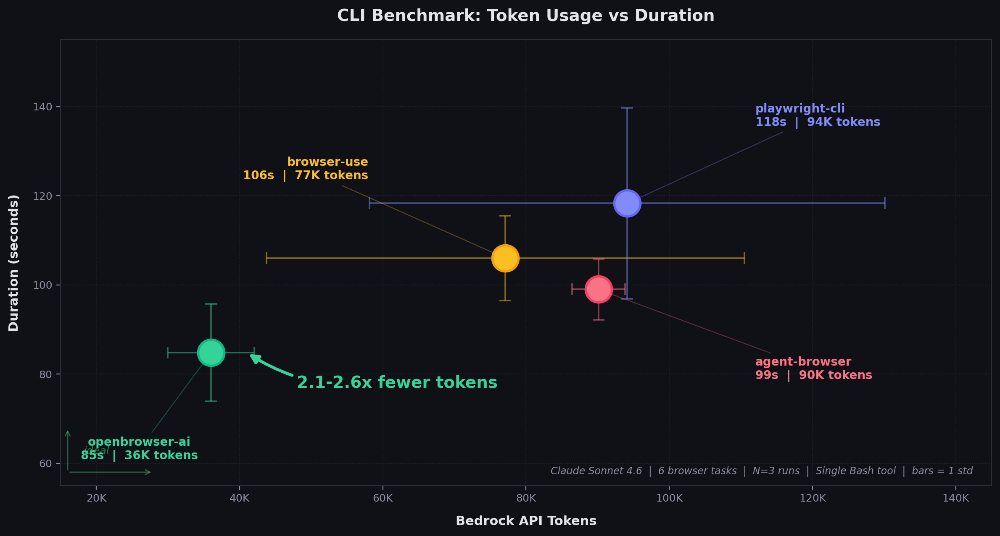
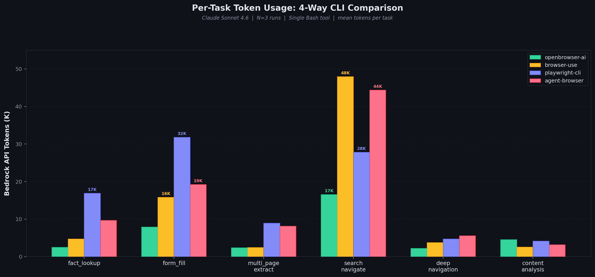

# OpenBrowser - Claude Code Plugin

<!-- toc:start -->
## Table of Contents

- [1. Prerequisites](#1-prerequisites)
- [2. Installation](#2-installation)
  - [2.1. From GitHub marketplace](#21-from-github-marketplace)
  - [2.2. Local development](#22-local-development)
  - [2.3. OpenClaw](#23-openclaw)
  - [2.4. skills.sh](#24-skillssh)
  - [2.5. Standalone MCP server (without plugin)](#25-standalone-mcp-server-without-plugin)
- [3. Available Tools](#3-available-tools)
- [4. Benchmark: Token Efficiency](#4-benchmark-token-efficiency)
  - [4.1. Native Local Benchmark (2026-11-24)](#41-native-local-benchmark-2026-11-24)
  - [4.2. CLI Benchmark: 4-Way Comparison (6 Tasks, N=3 runs)](#42-cli-benchmark-4-way-comparison-6-tasks-n3-runs)
  - [4.3. E2E LLM Benchmark: MCP Server Comparison (6 Tasks, N=5 runs)](#43-e2e-llm-benchmark-mcp-server-comparison-6-tasks-n5-runs)
- [5. Native web search](#5-native-web-search)
- [6. CLI Execute Mode](#6-cli-execute-mode)
- [7. Configuration](#7-configuration)
- [8. Skills](#8-skills)
- [9. Testing and Benchmarks](#9-testing-and-benchmarks)
- [10. Troubleshooting](#10-troubleshooting)
- [11. License](#11-license)

<!-- toc:end -->

AI-powered browser automation for Claude Code. Control real web browsers directly from Claude -- navigate websites, fill forms, extract data, inspect accessibility trees, and automate multi-step workflows.

Local CLI daemon sessions persist cookies and login state in Chrome's user-data directory at `~/.config/openbrowser/profiles/daemon` by default; no `storage_state.json` file is written unless you configure one explicitly. Each modern MCP context uses an isolated `~/.config/openbrowser/profiles/mcp-<owner-id>` profile and seeds its state once from `profiles/default/storage_state.json`, preventing concurrent contexts from terminating or corrupting one another's browser. The legacy no-handle owner uses `mcp-<server-instance-id>`. The owner ID is internal and is not the `context_id` handle; read the resolved path from `get_status.profile.user_data_dir`. MCP profiles are retained on disk after `close_context`, but a new server process cannot resume the old context handle. Configure `OPENBROWSER_USER_DATA_DIR` for a profile that survives restarts; `OPENBROWSER_STORAGE_STATE` is a one-time seed for managed profiles, and later changes are saved to the active profile copy rather than copied back automatically. Managed profiles also auto-clean disposable Chromium caches so they do not grow like normal long-lived Chrome profiles. Explicitly configured shared profiles are protected by a lease and reject concurrent owners.

## 1. Prerequisites

- **Chrome or Chromium** installed on your system
- **Python 3.12+** with [uv](https://docs.astral.sh/uv/) package manager
- **Claude Code** CLI

## 2. Installation

### 2.1. From GitHub marketplace

```bash
# Add the OpenBrowser marketplace (one-time)
claude plugin marketplace add billy-enrizky/openbrowser-ai

# Install the plugin
claude plugin install openbrowser@openbrowser-ai
```

This installs the MCP server, 8 skills, and auto-enables the plugin. Restart Claude Code to activate.

### 2.2. Local development

```bash
# Test from a local clone without installing
claude --plugin-dir /path/to/openbrowser-ai/plugin
```

### 2.3. OpenClaw

[OpenClaw](https://openclaw.ai) supports OpenBrowser via the CLI daemon. Install OpenBrowser,
then use `openbrowser-ai -c` from the Bash tool:

```bash
openbrowser-ai -c "await navigate('https://example.com')"
openbrowser-ai -c "print(await evaluate('document.title'))"
```

The daemon starts automatically on first use and persists variables across calls.

For OpenClaw plugin documentation, see [docs.openclaw.ai/tools/plugin](https://docs.openclaw.ai/tools/plugin).

### 2.4. skills.sh

Install the same skill pack with the skills.sh CLI:

```bash
npx skills add billy-enrizky/openbrowser-ai
```

Install only the setup skill:

```bash
npx skills add billy-enrizky/openbrowser-ai --skill setup -a codex
```

This command installs the setup skill file. It does not run the setup workflow. Invoke the `setup` skill after installation.

### 2.5. Standalone MCP server (without plugin)

Add to your project's `.mcp.json`:

```json
{
  "mcpServers": {
    "openbrowser": {
      "command": "uvx",
      "args": ["openbrowser-ai", "--mcp"]
    }
  }
}
```

The default stdio transport is the lean JSON-RPC loop. Set `OPENBROWSER_MCP_TRANSPORT=sdk` to use the MCP SDK transport instead. Invalid values exit with code 2.

## 3. Available Tools

A `2026-07-28` MCP client sees seven tools: `create_context`, `execute_code`, `get_status`, `reset_browser`, `close_context`, `search_web`, and `scrape_web`. The legacy handshakes `2024-11-05`, `2025-03-26`, `2025-06-18`, and `2025-11-25` see four tools: `execute_code`, `get_status`, `reset_browser`, and `search_web`. Both catalogs include stateless `search_web`, which uses the package-native DDGS client. The modern catalog also includes `scrape_web`, which fetches one HTTP(S) page in OpenBrowser no-browser mode: it starts no Chrome, Blink, or V8 process and cannot run JavaScript, take screenshots, or use browser cookies. Neither stateless tool needs a `context_id` or starts a browser. Search snippets do not count as evidence. Scrape and read source pages before you cite them.

For stateful calls, call `create_context` first and keep the returned `context_id`. Pass that handle to `execute_code`, `get_status`, and `reset_browser`, then call `close_context` when finished. `execute_code` runs Python code in a persistent per-context namespace with browser automation functions. `get_status` is a read-only lifecycle and tab snapshot. `reset_browser` closes a stuck browser while preserving scalar and scalar-only container variables by default. Inspect `namespace_transfer.dropped` for names that could not be carried. `close_context` releases the context and its browser profile.

A context is process-local. The handle lives until `close_context` or server exit, and a new MCP server process cannot resume it. The browser session inside a context auto-closes after 10 minutes without an `execute_code` call. `get_status` does not refresh that timer. The context handle and scalar variables remain available, and the next `execute_code` call starts a fresh browser. A successful `close_context` invalidates the handle. If cleanup fails, the result is `close_failed` with a retryable flag. Retry `close_context` to finish cleanup; the handle remains unavailable for `execute_code`, `get_status`, and `reset_browser`. New calls while closing fail with `context_closing`, and non-close calls after a failed close fail with `context_close_failed`.

Older clients that negotiate `2024-11-05`, `2025-03-26`, `2025-06-18`, or `2025-11-25` see four tools: `execute_code`, `get_status`, `reset_browser`, and `search_web`. Stateful calls use a legacy no-handle context. OpenBrowser rejects other protocol versions with MCP error `-32602`. It does not downgrade them.

`get_status` also adds `browser.health` for an existing session. It reports the latest page crash, focus-recovery outcome, and local process binding. It is not a live page-readiness probe, and `process_present` is `null` when the current root is not bound to the recorded local owner or when process identity is inconclusive. Wait while recovery is pending. Reset only when no usable target exists.

Authenticated browser state persists within one context, so later calls in that context keep using the same cookies and localStorage. A different context, or a new context after close, gets a separate managed profile seeded from the default profile. Use an explicit shared `OPENBROWSER_USER_DATA_DIR` when state must cross contexts; concurrent owners of that profile are rejected by the lease.

**Functions** (use `await` unless noted):

| Category | Functions |
|----------|-----------|
| **Navigation** | `navigate(url, new_tab)`, `go_back()`, `wait(seconds)` |
| **Interaction** | `click(index)`, `input_text(index, text, clear)`, `scroll(down, pages, index)`, `send_keys(keys)`, `upload_file(index, path)` |
| **Coordinate interaction** | `click_xy(x, y, button, click_count)`, `hover_xy(x, y)`, `scroll_xy(x, y, delta_x, delta_y)` for no-index canvas, PDF, embedded, and native-rendered targets |
| **Dropdowns** | `select_dropdown(index, text)`, `dropdown_options(index)` |
| **Tabs** | `switch(tab_id)`, `close(tab_id)` |
| **JavaScript** | `evaluate(code)` -- run JS in page context, returns Python objects |
| **Downloads** | `download_file(url, filename)` -- download a file using browser cookies; `wait_for_download(timeout, url, lookback, download_ref)` -- wait for a terminal download phase; `download_outcomes()` and `download_failures()` (sync); `list_downloads()` (sync) -- list downloaded files |
| **State** | `browser.get_browser_state_summary()` -- page metadata and interactive elements |
| **CSS** | `get_selector_from_index(index)` -- CSS selector for an element |
| **Search and scraping** | `search_web(query, max_results, backend, region, safe_search, timelimit)`, `search_and_scrape(query, max_results, concurrency, format, ...)`, `scrape_page(url, format, selector, wait_for, engine)`, `scrape_pages(urls, concurrency, format, selector, engine)` |
| **CSS fast paths** | `click_selector(selector, timeout)`, `fill_selector(selector, text)`, `wait_for_selector(selector, timeout)`, `click_selector_and_wait_for_new_tab(selector)` |
| **Completion** | `done(text, success)` -- signal task completion |

Prefer indexed actions whenever an element index exists. Coordinate actions use CSS viewport pixels, not screenshot pixels. If a screenshot uses a `devicePixelRatio` other than 1, divide its coordinates by `window.devicePixelRatio` before calling an `*_xy` function.

**Bundled libraries**: `json`, `csv`, `re`, `datetime`, `asyncio`, `Path`, `requests`, `numpy`/`np`, `pandas`/`pd`

**Available only if installed**: `matplotlib`, `BeautifulSoup`, `PdfReader` (requires `pip install openbrowser-ai[pdf]`), `tabulate`

## 4. Benchmark: Token Efficiency

### 4.1. Native Local Benchmark (2026-11-24)

Current local deterministic fixtures show OpenBrowser winning all five sequential scraping tasks against Firecrawl Local, 50 of 50 paired samples. Pagination measured 3.02 ms against 4.42 ms, and static article measured 0.94 ms against 1.54 ms. On the native batch surface, OpenBrowser HTTP batch measured 2.834 ms p50 against Firecrawl Local batch at 13.448 ms, a 4.75x win in 10 of 10 pairs. No browser started for the OpenBrowser batch.

OpenBrowser no-browser mode measured 142.7 ms and 47.6 MiB process-tree RSS on a local fixture for a static page. The scrape browser fallback uses the Playwright headless shell by default, measured at 355.4 to 382.1 MiB process-tree RSS on the same fixture, against 742.4 to 754.8 MiB for full Chrome.

The warm interactive lane uses the OpenBrowser MCP arm. Paired runs won 10 of 10 against the closest competitor on every task: wizard 121.966 ms vs browser-use 446.056 ms, modal 267.286 ms vs 806.803 ms, tabs 140.130 ms vs 220.321 ms, and download 393.629 ms vs agent-browser 482.813 ms. The cold lane beats chrome-devtools-mcp on all five tasks and browser-use on two, and still trails browser-use on download and tabs. See the [charted comparison](https://docs.openbrowser.me/comparison) and the raw artifacts under [`benchmarks/`](../benchmarks/).

### 4.2. CLI Benchmark: 4-Way Comparison (6 Tasks, N=3 runs)

Four CLI tools compared with a single Bash tool each. Claude Sonnet 4.6 on Bedrock. Randomized order. All achieve 100% accuracy.

<p align="center">
  
</p>

| CLI Tool | Duration | Tool Calls | Bedrock API Tokens |
|----------|----------|-----------|-------------------|
| **openbrowser-ai** | **84.8 +/- 10.9s** | **15.3 +/- 2.3** | **36,010 +/- 6,063** |
| browser-use | 106.0 +/- 9.5s | 20.7 +/- 6.4 | 77,123 +/- 33,354 |
| agent-browser | 99.0 +/- 6.8s | 25.0 +/- 4.0 | 90,107 +/- 3,698 |
| playwright-cli | 118.3 +/- 21.4s | 25.7 +/- 8.1 | 94,130 +/- 35,982 |

openbrowser-ai uses **2.1-2.6x fewer tokens** than all competitors via Python code batching and compact DOM representation. Raw data: [`benchmarks/e2e_4way_cli_results.json`](../benchmarks/e2e_4way_cli_results.json).

<p align="center">
  
</p>

[Full 4-way comparison](https://docs.openbrowser.me/cli-comparison)

### 4.3. E2E LLM Benchmark: MCP Server Comparison (6 Tasks, N=5 runs)

| MCP Server | Tools | Bedrock API Tokens | Tool Calls (mean) | vs OpenBrowser |
|------------|------:|-------------------:|-----------:|---------------:|
| **Playwright MCP** | 22 | 158,787 | 9.4 | **3.2x more tokens** |
| **Chrome DevTools MCP** (Google) | 26 | 299,486 | 19.4 | **6.0x more tokens** |
| **OpenBrowser MCP** | 1 (legacy catalog at benchmark time) | **50,195** | 13.8 | baseline |

| Model | Playwright MCP | Chrome DevTools MCP | OpenBrowser MCP |
|-------|---------------:|--------------------:|----------------:|
| Claude Sonnet 4.6 ($3/$15 per M) | $0.50 | $0.92 | **$0.18** |
| Claude Opus 4.6 ($5/$25 per M) | $0.83 | $1.53 | **$0.30** |

The OpenBrowser MCP entry used the legacy one-tool catalog at benchmark time. Current `2026-07-28` clients see seven tools. [Full MCP comparison with methodology](https://docs.openbrowser.me/comparison)

## 5. Native web search

Use `openbrowser-ai search "your query"` to search with the package-native DDGS client without starting a browser. The command calls `openbrowser.search` directly and does not shell out to a `ddgs` CLI. Use `--json` for a JSON array or `--urls-only` for one URL per line. Search snippets are not evidence. Scrape and read source pages before you cite them.

```bash
openbrowser-ai search "OpenBrowser MCP docs" --json --output search-results.json
openbrowser-ai search "OpenBrowser MCP docs" --urls-only --output search-urls.txt
openbrowser-ai scrape --urls-file search-urls.txt --no-browser --output scraped-pages.jsonl --output-format jsonl
```

`--no-browser` uses OpenBrowser no-browser mode. It starts no Chrome, Blink, or V8 process and cannot run JavaScript, take screenshots, or use browser cookies. Use the default `auto` engine when a page needs JavaScript.

## 6. CLI Execute Mode

Run browser automation directly from Bash without the MCP server:

```bash
# Execute code via persistent daemon
openbrowser-ai -c "await navigate('https://example.com')"
openbrowser-ai -c "print(await evaluate('document.title'))"

# Daemon management
openbrowser-ai daemon start|ensure|stop|force-stop|status|reset|restart|list|reap|doctor
```

Variables persist across `-c` calls while the daemon is running. The daemon starts automatically on first use and shuts down after 10 minutes of inactivity. A warm `-c` call uses a standard-library thin client, so it does not import the full CLI or agent stack. A cold call falls back to the full client and starts the daemon.

For static pages, `openbrowser-ai scrape URL1 URL2 --no-browser --jsonl` uses OpenBrowser no-browser mode. It uses a light console entry, does not import the browser or configuration stack, and starts no Chrome, Blink, or V8 process. It never falls back to a browser and cannot run JavaScript, take screenshots, or use browser cookies. Use this path for batch HTML extraction; use the default `auto` or explicit `browser` engine when a page needs JavaScript.

`openbrowser-ai scrape URL --only-main-content` drops navigation, headers, footers, cookie banners, and ad blocks before extraction. `--include-tag` keeps the first matching selector and `--exclude-tag` removes matches.

`openbrowser-ai map URL` lists the URLs a site exposes from the page and its sitemap. `openbrowser-ai crawl URL` follows same-origin links with `--max-pages` and `--max-depth` limits. Neither starts a browser.

Use `--text-only` on `scrape` to block external CSS, images, fonts, media, and text tracks while keeping scripts and screenshots, or `--no-css`, `--no-images`, `--no-fonts`, `--no-media`, and `--render-mode` for browser-fallback control. `--no-scripts` is available on the one-shot prompt interface, not on `scrape`. The scrape browser fallback uses the Playwright headless shell by default; set `OPENBROWSER_USE_HEADLESS_SHELL=0` to force full Chrome.

The CLI daemon uses `~/.config/openbrowser/profiles/daemon` as its default browser profile, so saved logins survive daemon restarts through Chrome's user-data directory. An explicit `storage_state` path is read and written by the storage-state watchdog at the configured path; that is separate from the MCP one-time seed behavior. Downloads default to `~/Downloads/openbrowser-daemon` and survive `daemon stop`. Daemon timeout, socket, and profile variables are listed in the CLI daemon guide. Custom sockets share the default profile unless `OPENBROWSER_DAEMON_PROFILE_ISOLATION=true` or `OPENBROWSER_DAEMON_PROFILE_DIR` is set. `OPENBROWSER_USER_DATA_DIR` takes precedence over both and always selects that explicit profile.

## 7. Configuration

Optional environment variables:

| Variable | Description |
|----------|-------------|
| `OPENBROWSER_MCP_TRANSPORT` | Stdio implementation: `lean` or `sdk` (default: `lean`) |
| `OPENBROWSER_HEADLESS` | Set to `true` to run browser without GUI |
| `OPENBROWSER_ALLOWED_DOMAINS` | Comma-separated domain whitelist |
| `OPENBROWSER_USER_DATA_DIR` | Optional explicit Chrome profile directory. Omit it for one managed profile per context; concurrent owners are rejected |
| `OPENBROWSER_STORAGE_STATE` | Optional JSON file used as a one-time seed for cookies plus localStorage in managed MCP profiles |
| `OPENBROWSER_COMPACT_DESCRIPTION` | Set to `true` for minimal tool description (~500 tokens) |
| `OPENBROWSER_MAX_OUTPUT` | Maximum output characters per execution (default: 10,000) |
| `OPENBROWSER_MCP_MAX_CONTEXTS` | Maximum open contexts total, including the legacy no-handle context (default: 16) |
| `OPENBROWSER_MCP_WORKSPACE_DIR` | Base directory for per-context workspaces (default: `~/Downloads/openbrowser-mcp/workspace`) |
| `OPENBROWSER_MCP_START_TIMEOUT` | Browser startup bound in seconds (default: 30) |
| `OPENBROWSER_MCP_EXEC_TIMEOUT` | Seconds before a tool call returns a timeout result (default: 110) |
| `OPENBROWSER_SHUTDOWN_TIMEOUT` | Browser and context cleanup bound in seconds (default: 20) |
| `ANONYMIZED_TELEMETRY` | Set to `false` to disable anonymized usage telemetry (default: `true`) |

Set these in your `.mcp.json`:

```json
{
  "mcpServers": {
    "openbrowser": {
      "command": "uvx",
      "args": ["openbrowser-ai", "--mcp"],
      "env": {
        "OPENBROWSER_HEADLESS": "true"
      }
    }
  }
}
```

## 8. Skills

The plugin includes 8 built-in skills that provide guided workflows for common browser automation tasks. All skills use the CLI-first approach via `openbrowser-ai -c` for direct code execution. Each skill is triggered automatically when the user's request matches its description.

| Skill | Directory | Description |
|-------|-----------|-------------|
| `setup` | `skills/setup/` | Install the CLI and Chromium, configure MCP and profiles, install skills, and verify a real browser session |
| `deep-research` | `skills/deep-research/` | Conduct deep, cited web research across multiple sources and produce markdown and JSON reports |
| `web-scraping` | `skills/web-scraping/` | Extract structured data from websites, handle pagination, and multi-tab scraping |
| `form-filling` | `skills/form-filling/` | Fill out web forms, handle login/registration flows, and multi-step wizards |
| `e2e-testing` | `skills/e2e-testing/` | Test web applications end-to-end by simulating user interactions and verifying outcomes |
| `page-analysis` | `skills/page-analysis/` | Analyze page content, structure, metadata, and interactive elements |
| `accessibility-audit` | `skills/accessibility-audit/` | Audit pages for WCAG compliance, heading structure, labels, alt text, ARIA, and landmarks |
| `file-download` | `skills/file-download/` | Download files (PDFs, CSVs, images) using the browser's authenticated session and read content |

Each skill file (`SKILL.md`) contains YAML frontmatter with trigger conditions and a step-by-step workflow. All skills use `openbrowser-ai -c` via the Bash tool for CLI-first browser automation.

## 9. Testing and Benchmarks

```bash
# E2E test the MCP server against the published PyPI package
uv run python benchmarks/e2e_published_test.py

# Run MCP benchmarks (5-step Wikipedia workflow)
uv run python benchmarks/openbrowser_benchmark.py
uv run python benchmarks/playwright_benchmark.py
uv run python benchmarks/cdp_benchmark.py
```

## 10. Troubleshooting

**Browser does not launch**: Ensure Chrome or Chromium is installed and accessible from PATH.

**MCP server not found**: Verify `uvx` is installed (`pip install uv`) and the MCP server starts (`uvx openbrowser-ai --mcp`).

**Session timeout**: Browser sessions auto-close after 10 minutes without an `execute_code` call. `get_status` does not refresh the timer. The context remains open and the next `execute_code` call starts a fresh browser.

## 11. License

MIT
